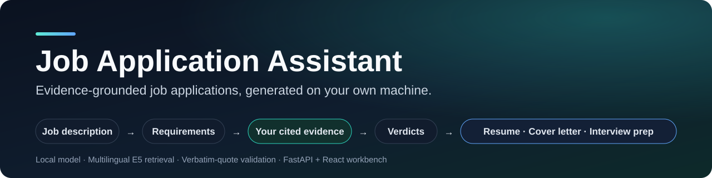
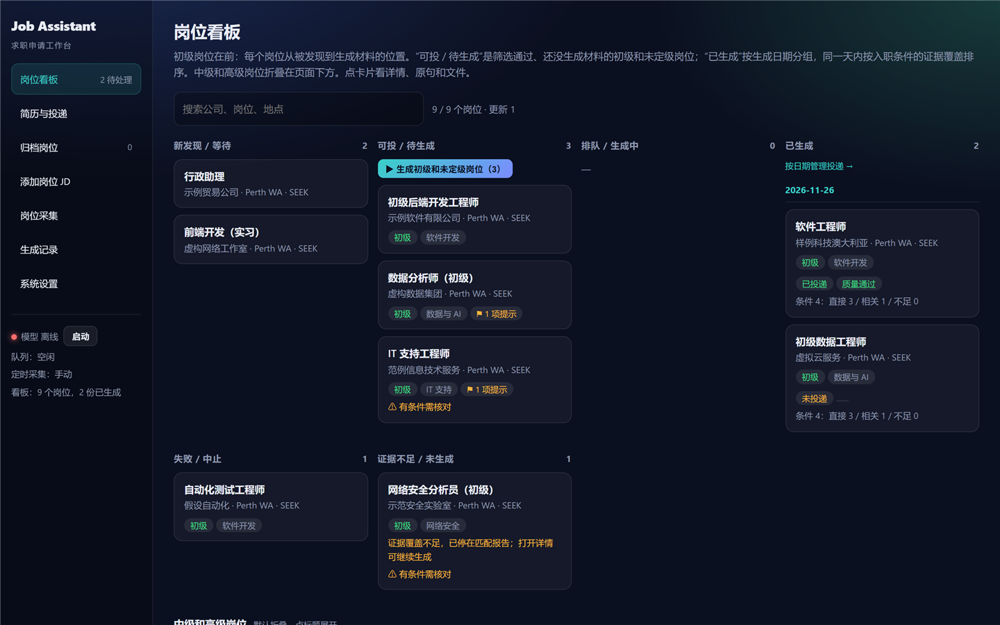
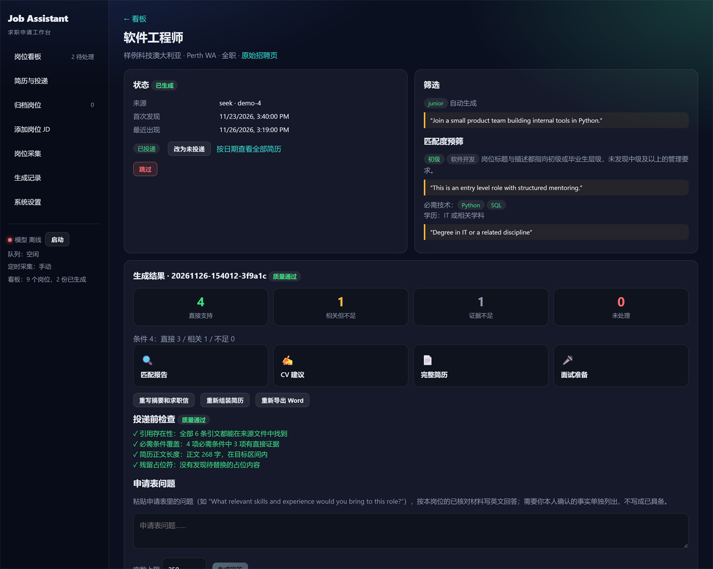
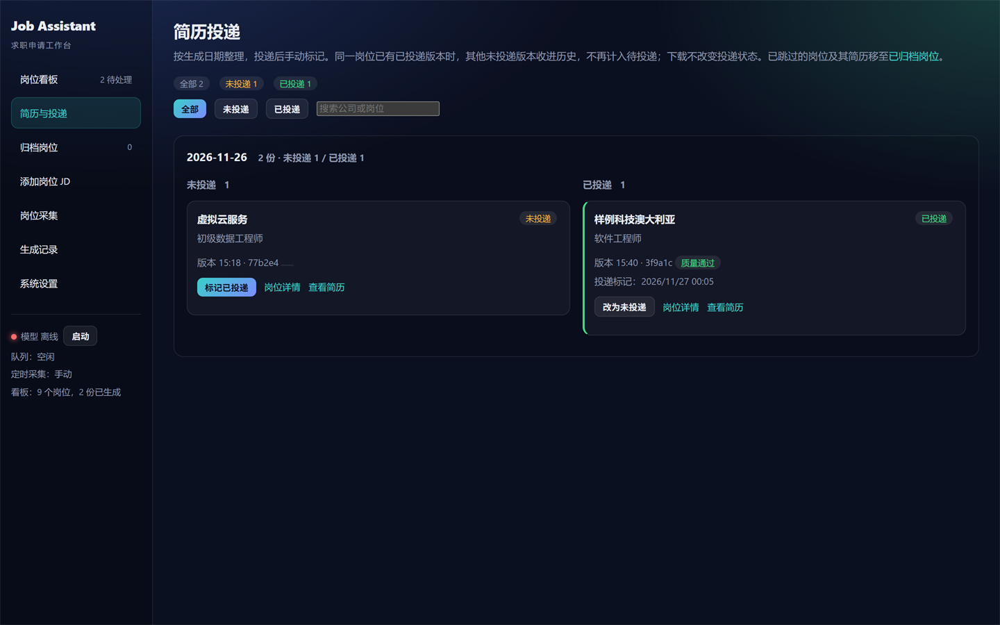
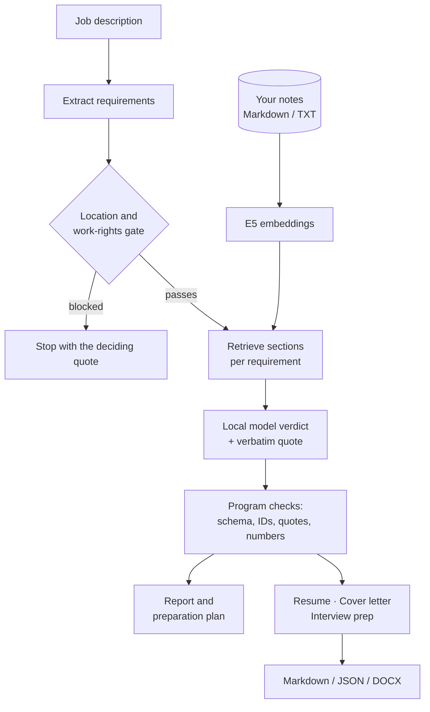

<div align="center">



<p>
  <a href="https://github.com/Maxwell2048/job-application-assistant/actions/workflows/tests.yml"></a>
  <a href="LICENSE"></a>
  
  
  
  
  
</p>

<p><b>Every claim cites a line you actually wrote.</b><br>
Point it at a job description and your own project notes. Get back a matching report, a preparation plan,<br>
a tailored resume, a cover letter and interview preparation, each traced to verbatim evidence.</p>

<p>
  <a href="#-quickstart"><b>Quickstart</b></a> ·
  <a href="#-how-it-works"><b>How it works</b></a> ·
  <a href="#-screenshots"><b>Screenshots</b></a> ·
  <a href="#-documentation"><b>Docs</b></a> ·
  <a href="README.zh-CN.md"><b>简体中文</b></a>
</p>



<sub>The job board on fictional demo data. The interface and generated reports are in Chinese; your material and job descriptions can be in Chinese or English.</sub>

</div>

<br>

## 🤔 Why this exists

AI resume generators write confident prose from nothing. This one refuses to. It retrieves from a private library of **your own** project records, asks a local model to judge each requirement against what it found, and **rejects any quotation that is not literally in your source**.

| | Typical AI resume generator | Job Application Assistant |
|---|---|---|
| Where claims come from | Whatever the model writes | Your notes, retrieved and quoted word for word |
| An invented number or tool | Ends up in the resume | Rejected by a program check and retried |
| Team work | Often becomes "I built…" | Personal and team sections are told apart; team-only citations are rejected |
| A requirement you cannot meet | Papered over | Marked `insufficient` and listed as a gap to prepare |
| Your data | Sent to a cloud API | Stays on your machine; the model runs on loopback |
| What you can check | The final text | Every line links to the section and quote it came from |

> [!NOTE]
> Retrieval similarity is not a hiring probability, and missing evidence does not mean you lack a skill. Every generated document is a draft for you to review before sending.

## ✨ Highlights

<table>
<tr>
<td width="50%" valign="top">

### 🔎 Evidence retrieval
Multilingual E5 search over your own Markdown and text notes. Chunks keep their headings, so every citation points at the paragraph it came from.

</td>
<td width="50%" valign="top">

### ⚖️ Per-requirement verdicts
`direct`, `related` or `insufficient` for each requirement, pinned to a verbatim quote. A processing failure is recorded as a failure, never as "no evidence".

</td>
</tr>
<tr>
<td valign="top">

### 📝 Grounded drafting
Tailored resume, cover letter, interview questions, STAR answers and application-form answers. Each can only use what the evidence supports.

</td>
<td valign="top">

### 🧭 Screening before you spend time
Location and work-rights gate, seniority and fit checks, student-only detection and six role families. Roles that do not fit stop early, with the quote that decided it.

</td>
</tr>
<tr>
<td valign="top">

### 🖥️ A workbench, not a script
FastAPI + React board with live stage progress, manual JD submission, scheduled collection, run history, a pre-send quality report and resume-version tracking.

</td>
<td valign="top">

### 🔒 Private by design
Runs against a local, OpenAI-compatible model. There is no cloud fallback, and LangSmith tracing is refused, because prompts contain your source text.

</td>
</tr>
</table>

## 📸 Screenshots

All screenshots use fictional demo data: no real postings, no personal material.

<table>
<tr>
<td width="50%"></td>
<td width="50%"></td>
</tr>
<tr>
<td><b>A generated job.</b> The verbatim screening quote, verdict counts per requirement, the documents produced, pre-send quality checks and the application-answer box.</td>
<td><b>Resume tracking.</b> Versions grouped by date, each with its own submitted state. Downloading a file does not mark it submitted.</td>
</tr>
</table>

## 🚀 Quickstart

You need **Python 3.12** (CI also runs 3.13), **Node 22** once to build the frontend, and a **local model server** exposing an OpenAI-compatible `/v1/chat/completions` (for example llama.cpp or Ollama).

```powershell
git clone https://github.com/Maxwell2048/job-application-assistant.git
cd job-application-assistant
Copy-Item config.local.example.json config.local.json   # set "model" and "base_url"
.\start.bat                                             # opens http://127.0.0.1:8000
```

`start.bat` creates the virtual environment, installs the backend, builds the frontend once, applies database migrations and opens the board. It does not start your model server: start that yourself, or set `RAG_MODEL_LAUNCHER` to a script that does and use the **启动** (Start) button. Put your current resume at `resume/base_resume.docx`.

<details>
<summary><b>Prefer the command line? Try the fictional sample first</b></summary>

```powershell
py -3.12 -m venv .venv
.\.venv\Scripts\python.exe -m pip install -r requirements.txt
.\.venv\Scripts\python.exe search_experience.py --data examples/experiences --check
.\.venv\Scripts\python.exe match_job.py --jd examples\junior_developer_jd.txt --data examples/experiences --config config.local.json --top-k 3
```

`examples/experiences/demo_project.md` is fictional and must not be used as real application evidence. `--check` reads the files without loading the model. The first real search downloads the E5 weights (470 MB); add `--offline` once they are cached.

| | Web app | Command line |
|---|---|---|
| Run the matching pipeline | ✅ submit page | ✅ `match_job.py` |
| Collect and screen postings | ✅ autopilot | ✅ `-m backend.app.autopilot tick` |
| Track resume versions and submissions | ✅ | ❌ |
| Static report viewer | ✅ built in | ✅ `build_site.py` |
| Scriptable / batchable | partly | ✅ |

</details>

<details>
<summary><b>Requirements and disk space</b></summary>

| Item | Detail |
|---|---|
| Python | 3.12 tested, 3.13 in CI |
| Node | 22, only to build the frontend |
| Model | Any OpenAI-compatible endpoint; nothing is bundled or trained here |
| Virtual environment | about 1.2 GB |
| `intfloat/multilingual-e5-small` | 470 MB, runs on CPU |
| Frontend dependencies | 84 MB at build time; the built app is 299 KB |

</details>

## 🧠 How it works



**What a verdict looks like.** The fictional sample in `examples/` asks for Flask, SQL joins, Git, Docker and automated testing. The evidence file mentions the first three and not the last two, so a run is expected to come out like this:

| Requirement | Verdict | Evidence |
|---|---|---|
| Python web applications with Flask | `direct` | "我负责使用 Python 和 Flask 实现预约创建与取消接口。" (`demo_project.md` › 后端开发) |
| SQL joins and parameterized queries | `direct` | "我编写 SQL JOIN 查询，关联预约记录与房间信息，并用参数化查询处理输入。" |
| Git and pull requests | `direct` | "我与三位组员通过 Git 分支和 Pull Request 协作。" |
| Docker (preferred) | `insufficient` | No section mentions it; it is listed as something to prepare, not claimed |
| Automated testing (preferred) | `insufficient` | Same |

*This table illustrates the report format with the fictional sample. Your verdicts come from your own model run.*

<details>
<summary><b>The eight stages in detail</b></summary>

| Stage | What it does |
|---|---|
| 1. Extract | Turns the JD into structured requirements: required versus preferred, qualifiers, AND/OR relationships. |
| 2. Gate | Screens location and work rights before retrieval. A role that is mandatory on-site outside Western Australia, with no WA or remote-from-WA option, stops the pipeline (exit code 3). |
| 3. Retrieve | E5 query/passage prefixes, normalized-vector dot products, 320-token windows with 40-token overlap, deduplicated by section so you get whole original paragraphs. |
| 4. Judge | One verdict per requirement with a verbatim quote. Failures are a separate state from insufficient evidence. |
| 5. Validate | JSON structure, requirement IDs, candidate IDs and quote presence are checked programmatically before anything is written. |
| 6. Summarise | Strengths, evidence gaps, prioritised learning exercises with completion criteria. |
| 7. Draft | CV suggestions, cover letter, resume assembly, interview questions and STAR preparation. |
| 8. Export | Word documents, previewed in your office software before sending. |

The retriever prefers personal-contribution sections over derived CV/STAR wording when documents follow the project template. Vectors live in memory; there is no persistent vector database or embedding cache. The backend runs the stages as a LangGraph state graph by default; `RAG_GENERATION_ENGINE=classic` runs the same stages in plain Python, and parity tests require identical results ([docs/langchain-langgraph.md](docs/langchain-langgraph.md)).

</details>

## 📊 By the numbers

<table>
<tr>
<td align="center"><b>518</b><br><sub>Python tests</sub></td>
<td align="center"><b>12</b><br><sub>frontend tests</sub></td>
<td align="center"><b>2 OS × 2 Python</b><br><sub>CI matrix</sub></td>
<td align="center"><b>27</b><br><sub>API endpoints</sub></td>
<td align="center"><b>14</b><br><sub>command-line tools</sub></td>
<td align="center"><b>13×</b><br><sub>faster board at 5,000 jobs</sub></td>
</tr>
</table>

- **Tests:** 339 engine and CLI, 132 backend API and 47 collector tests, all on synthetic fixtures, plus frontend tests and a production build in CI.
- **Scale:** with 5,000 jobs and 1,500 runs the board went from 5.7 s and 11,506 SQL statements to 0.43 s and 32 statements, after batch loading and a signature-keyed run-summary cache. See [docs/performance.md](docs/performance.md) and rerun it with `tools/perf/bench_list_api.py`.

## 🏗️ Tech stack

| Layer | Technology |
|---|---|
| Retrieval | `sentence-transformers`, `intfloat/multilingual-e5-small`, optional LangChain `InMemoryVectorStore` |
| Model access | Any OpenAI-compatible local server (llama.cpp, Ollama, …) over HTTP or LangChain `ChatOpenAI`; JSON Schema output with bounded retries |
| Orchestration | LangGraph state graph with checkpoints, or a plain Python flow |
| Backend | FastAPI, SQLAlchemy, Alembic, SQLite or PostgreSQL, server-sent events |
| Frontend | React, TypeScript, Vite |
| Documents | python-docx export with company-led English file names |
| Delivery | GitHub Actions on Ubuntu and Windows; `compose.yaml` for PostgreSQL, API and nginx |

## 🗺️ Roadmap

- [x] Evidence retrieval, per-requirement verdicts and verbatim-quote validation
- [x] Grounded resume, cover letter, interview and application-answer drafting
- [x] Web workbench with collection, screening, queueing and resume tracking
- [x] LangChain and LangGraph behind switches, with parity tests
- [x] List endpoints that stay fast as runs accumulate
- [ ] A larger synthetic public evaluation corpus
- [ ] Stronger checks that a quotation actually supports the claim it backs
- [ ] Persistent embedding cache
- [ ] Broader platform and model compatibility testing

Unchecked items are planned improvements, not current guarantees.

## 📖 Reference

<details>
<summary><b>Web pages</b></summary>

| Page | What it does |
|---|---|
| Board | Every job by status, with the screening verdict, its verbatim quote and a "ready" column. Junior roles come first; mid and senior roles are folded below. |
| Job | Live stage progress, rendered documents, Word downloads, and the location-gate evidence in a popup. |
| Submit | Paste a JD by hand and run it immediately. Aborting a pasted-JD task removes its unfinished run directory and saved JD file. |
| Autopilot | Manual collection rounds, mode switch, status and history. |
| Runs | Run history, read only. |
| Resume | Generated versions grouped by date, each with its own submitted/unsubmitted state. |
| Settings | Read-only view of the effective configuration. |

Progress arrives over server-sent events. One generation runs at a time because the local model has a single slot.

</details>

<details>
<summary><b>Command-line walkthrough</b></summary>

Replace `YOUR_RUN_DIRECTORY` with the directory printed by the matching command:

```powershell
$runDir = 'outputs\YOUR_RUN_DIRECTORY'

# Regenerate the preparation summary without rerunning retrieval
.\.venv\Scripts\python.exe job_summary.py --run $runDir --config config.local.json

# Create application drafts and assemble the resume
.\.venv\Scripts\python.exe tailor_cv.py --run $runDir --resume resume\base_resume.docx --config config.local.json
.\.venv\Scripts\python.exe build_resume.py --run $runDir --resume resume\base_resume.docx --config config.local.json

# Check quality before sending, then export and prepare interviews
.\.venv\Scripts\python.exe quality_report.py --run $runDir
.\.venv\Scripts\python.exe job_identity.py --run $runDir --config config.local.json   # company and job title for file names
.\.venv\Scripts\python.exe export_docx.py --run $runDir --letter
.\.venv\Scripts\python.exe interview_prep.py --run $runDir --config config.local.json

# Refresh the static viewer
.\.venv\Scripts\python.exe build_site.py
```

Save a job description from the clipboard, a file or standard input:

```powershell
.\.venv\Scripts\python.exe add_jd.py
.\.venv\Scripts\python.exe add_jd.py --file draft.txt
.\.venv\Scripts\python.exe add_jd.py --stdin
```

`match_job.py` returns `0` for a completed matching stage, `1` for failed or partial processing, `2` for invalid arguments, and `3` when the location gate blocks the role. `tailor_cv.py`, `interview_prep.py` and `build_resume.py` return `0` when complete, `1` for partial output or a failed generation, and `2` when the input was unusable and nothing was written. The optional summary has a separate status.

</details>

<details>
<summary><b>Outputs of a run</b></summary>

Matching creates `outputs/<timestamp>-<suffix>/`:

| Artifact | Contents |
|---|---|
| `jd.txt` | Normalized JD used for source locations |
| `requirements.json` | Requirements, qualifiers, relationships, extraction failures |
| `matches.json` | Judgements and evidence references |
| `job_summary.json` | Preparation advice, or summary failure details |
| `report.md` | Matching report and preparation summary |
| `run_meta.json` | Run status, input hashes, model settings, errors |
| `cv_suggestions.*` | Optional CV suggestions and cover-letter drafts |
| `resume_tailored.*` | Optional assembled resume (Markdown and JSON) |
| `job_identity.json` | Optional hiring company and job title, each checked to be wording of the JD |
| `<Name>_Resume_<Company>_<Job-Title>_<MMDD-HHMM>.docx`, `<Name>_Cover_Letter_…docx` | Optional Word exports with English-only names that lead with the company; `--label` overrides the company part |
| `interview_prep.*` | Optional interview preparation |

Extraction-only runs produce the extraction subset. Later generation may add numbered versions. Regenerating a summary updates `report.md` and `job_summary.json`; Word export can replace the DOCX associated with its selected Markdown input.

</details>

<details>
<summary><b>Configuration: <code>config.local.json</code></b></summary>

Copied from the example and never committed:

| Field | Meaning |
| --- | --- |
| `model` | Model identifier accepted by your service |
| `base_url` | Local endpoint, for example `http://127.0.0.1:1234/v1` |
| `api_key` | Local service credential if required; never commit real credentials |
| `context_budget` | Model context window in tokens |
| `max_output_tokens` | Reserved output tokens; must be smaller than the context window |
| `chars_per_token` | Heuristic input-budget conversion, not exact tokenization |
| `timeout_seconds` | Per-request timeout |
| `response_format` | `json_object`, `json_schema`, or `none`, according to server support |
| `extra_body` | Optional server-specific request settings |
| `local_model_endpoints` | Optional list of loopback endpoints tried in order, each `{"base_url": ..., "model": ...}`; the first one whose `/v1/models` reports a listed model as loaded is used. Add `"models": [...]` when different engines on the same port report different names |
| `adapter` | `openai_http` (plain HTTP) or `langchain_openai` (same request through LangChain's `ChatOpenAI`; schema checks, quote validation and retries unchanged). LangSmith tracing must stay off, because prompts contain your source text |
| `retriever` | `native` (default) or `langchain` (the same E5 chunks in a LangChain `InMemoryVectorStore`, same ranking) |

The example includes a model-specific thinking-mode setting; remove or adapt it if your server does not support it. There is no automatic cloud fallback: the configured endpoint receives personal source text, so keep it local if local processing is required.

</details>

<details>
<summary><b>Backend settings: <code>RAG_*</code> environment variables</b></summary>

Every backend setting is an environment variable with the `RAG_` prefix, or a line in a root `.env` file:

| Variable | Default | Purpose |
|---|---|---|
| `RAG_DATABASE_URL` | `sqlite:///state/rag.sqlite` | Ledger backend |
| `RAG_HOST` / `RAG_PORT` | `127.0.0.1` / `8000` | Bind address |
| `RAG_OUTPUTS_DIR` | `outputs/` | Where runs are written |
| `RAG_COLLECTOR_DIR` | unset | Private runtime directory for the SEEK collector cache, cursors and collected output |
| `RAG_GENERATION_ENGINE` | `langgraph` | `langgraph` or `classic` |
| `RAG_AUTOPILOT_ENABLED` | `false` | Scheduled collection at start-up |
| `RAG_ALLOW_REMOTE` | `true` | Accept nationwide remote roles that permit working from WA |

</details>

<details>
<summary><b>Deployment: local, containers and database</b></summary>

`start.bat` covers the whole flow on Windows. The manual equivalent:

```powershell
.\.venv\Scripts\python.exe -m pip install -r requirements-backend.txt
Push-Location frontend
npm ci
npm run build
Pop-Location
.\.venv\Scripts\python.exe -m backend.app.main        # API docs at /docs; add --port 8010 for another port
```

`compose.yaml` provides PostgreSQL, the API and an nginx frontend. Model inference stays on the host; create `config.docker.json` from the example and point it at the host endpoint. Published ports bind to loopback. The application has no authentication and is intended for local use. Container configuration is included; cloud deployment and production operations are not claimed.

SQLite is the default single-machine ledger at `state/rag.sqlite`. Set `RAG_DATABASE_URL` to use PostgreSQL. Schema changes are Alembic migrations:

```powershell
.\.venv\Scripts\python.exe -m alembic -c backend/alembic.ini upgrade head
```

Back up an existing database before upgrading. Board and resume lists read cached run summaries from `run_summary_cache`, rebuilt only when a run directory's files change. The table holds derived data and may be deleted at any time.

</details>

<details>
<summary><b>Testing</b></summary>

CI runs synthetic engine tests and backend API tests on Ubuntu and Windows with Python 3.12 and 3.13, collector tests without live network requests, and frontend regression tests plus a production build. Frontend tests cover pure grouping, visibility and refresh logic; browser end-to-end coverage is not claimed.

```powershell
python -X utf8 -m unittest discover -s tests -v
python -X utf8 -m unittest discover -s backend/tests -t . -v
python -X utf8 -m unittest discover -s tools/seek_collector -p "test_*.py" -q
Push-Location frontend
npm ci
npm test
npm run build
Pop-Location
```

```powershell
# Small public smoke evaluation: four fictional requirements, three with recall targets
.\.venv\Scripts\python.exe tests/run_eval.py
.\.venv\Scripts\python.exe tests/run_eval.py --offline    # after the embedding model is cached
.\.venv\Scripts\python.exe tests/run_eval.py --config config.local.json   # optional local-model evaluation
```

The default evaluation uses `examples/experiences/` and `tests/public_eval_set.json`. It is a smoke check, not a model-accuracy benchmark. Mock tests validate software behaviour, not hiring success.

</details>

<details>
<summary><b>Project layout</b></summary>

```text
Root modules (24)
  search_experience.py     Ingestion and reusable E5 retrieval
  jd_parser.py             JD extraction and source locations
  location_gate.py         Western Australia work-rights screening
  evidence_matcher.py      Evidence judgement and quotation checks
  local_llm.py             Model adapter, schema validation, bounded retries
  langchain_client.py      Optional LangChain chat adapter
  langchain_retrieval.py   Optional LangChain vector-store retriever
  match_job.py             Matching workflow
  job_family.py            Job family of a JD (headline and emphasis)
  job_identity.py          Hiring company and job title, for export file names
  job_summary.py           Strengths, gaps, preparation advice
  report_writer.py         Matching reports
  tailor_cv.py             Application drafting
  build_resume.py          Resume assembly
  resume_review.py         Reorder existing project blocks for a job
  resume_skills.py         Candidate-confirmed skill presentation rules
  quality_report.py        Pre-send quality report, no model call
  application_answer.py    Answer an application-form question
  export_docx.py           Word export
  interview_prep.py        Interview and STAR preparation
  add_jd.py                Save a JD from clipboard, file or stdin
  build_site.py            Static report viewer
  import_uwa_kb.py         Optional importer for a course-project knowledge base
  make_public_release.py   Build a source-only release copy and scan it

backend/                   FastAPI API, ledger (SQLAlchemy + Alembic), worker, autopilot
frontend/                  React + TypeScript app (Vite)
tools/seek_collector/      SEEK collection, screening lanes, refusal handling
tools/perf/                Scale benchmark for the list endpoints
docs/                      Design notes
examples/                  Fictional demonstration inputs
tests/                     Regression and evaluation tooling
compose.yaml               PostgreSQL + API + nginx frontend
```

`import_uwa_kb.py` is an optional importer for the original course-project knowledge-base format; it is not required for general use.

</details>

## 📚 Documentation

| Doc | Contents |
|---|---|
| [docs/application-workflow.md](docs/application-workflow.md) | Configuration, screening behaviour, application workflow |
| [docs/langchain-langgraph.md](docs/langchain-langgraph.md) | The three switches, the state graph, how equivalence was checked |
| [docs/performance.md](docs/performance.md) | Why the lists slowed down, measurements, how to rerun the benchmark |
| [docs/jd_matcher_spec.md](docs/jd_matcher_spec.md) | Matching specification: inputs, stages, outputs, guarantees |
| [CHANGELOG.md](CHANGELOG.md) | Dated changes with links to commits and pull requests |

## ❓ FAQ

<details>
<summary><b>The model endpoint is unreachable.</b></summary>

Check the server separately at `http://127.0.0.1:<port>/v1/models`, confirm `base_url` includes `/v1`, and put the full address in `config.local.json`. With `local_model_endpoints` set, the app tries each entry in order and uses the first one that reports a loaded model. The **启动** (Start) button only helps when `RAG_MODEL_LAUNCHER` points at a script that starts the server.

</details>

<details>
<summary><b>Port 8000 is already taken.</b></summary>

Start with another port, `.\.venv\Scripts\python.exe -m backend.app.main --port 8010`, and open `http://127.0.0.1:8010`.

</details>

<details>
<summary><b>The first run is slow and the network is busy.</b></summary>

The first search downloads the E5 weights (470 MB). Afterwards pass `--offline` on the CLI, or keep the cache and let the app use it. An air-gapped machine needs the model cache pre-populated.

</details>

<details>
<summary><b>A Word file looks different from the preview.</b></summary>

Appearance depends on fonts and the office software installed. Preview the export on the machine you will send from.

</details>

<details>
<summary><b>Does my material leave this machine?</b></summary>

Only the endpoint you configure receives source text. Keep it on loopback and nothing leaves. LangSmith tracing is refused on purpose for the same reason.

</details>

## ⚠️ Limitations

- A local prototype for one person, not a production multi-user service.
- A valid quotation can still be misinterpreted; application claims need human review.
- Top-K retrieval can miss evidence or return weak candidates. Similarity is only a ranking signal.
- Context planning uses character-budget heuristics, not exact model token counts.
- Numeric checks establish source presence, not correct experimental interpretation.
- DOCX appearance depends on fonts and office software.
- Source quality and personal/team ownership boundaries affect every generated result.
- The system uses pretrained models; it does not train or fine-tune them.
- The collector does not guarantee access to third-party listings and stops on refusal or rate limiting.

## 🔐 Data handling and public release

Keep personal experiences, resumes, credentials, JDs, generated applications, screenshots and source-review notes private. Public examples must be fictional or explicitly approved.

This application was developed inside a larger personal workspace. Ignore rules exclude private directories from **new** Git additions; they do not remove tracked files or erase old commits. Prepare and review a separate source-only release before publishing.

`make_public_release.py --out <directory>` copies an allowlist into a new or empty directory. Existing files are never overwritten or deleted; `--clean` is unsupported. Every copied text file, including the release script, is scanned for common secret formats. For personal identifiers, supply `--private-patterns <private-file.json>` with a JSON array of regex strings stored outside the release directory; this file is never copied. Automated checks cannot detect all personal data, so review the output before publishing from a separate Git repository. Exclude `config.local.json`, `experiences/`, `resume/`, `_sources/`, `_review/`, `jobs/`, `outputs/` and `site/`.

## 🤝 Contributing

Bug reports should include a minimal fictional input, the command, platform and Python version, and a credential-free model configuration. Do not attach private resumes or raw personal outputs.

In pull requests, explain user-visible changes, add meaningful regression tests and run the relevant suites. Keep retrieval, model access, validation and rendering separate. Use synthetic content for layout previews.

## 📄 License

MIT License, see [LICENSE](LICENSE). Model and dependency licenses remain separate.

<div align="center"><sub>Built for job seekers who would rather send fewer, truer applications.</sub></div>
