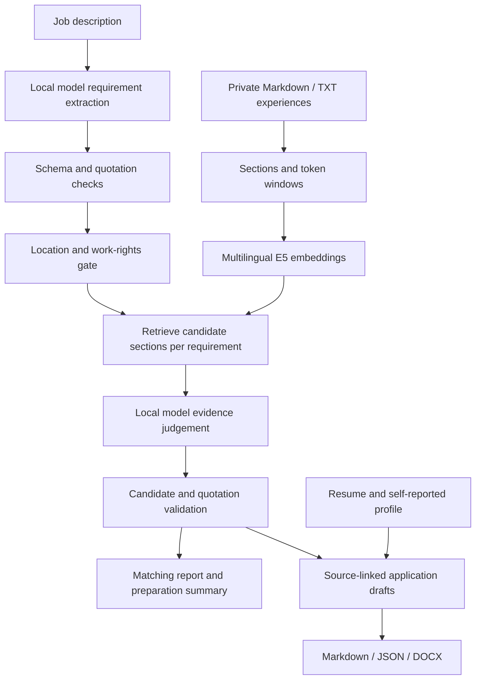

# Job Application Assistant

**English** | [简体中文](README.zh-CN.md)

> Point it at a job description and your own project notes. Get back an evidence-linked matching report, a preparation plan, CV suggestions, a cover letter, an assembled resume and interview preparation — with every claim traced to a line you actually wrote.

**24 modules** · 14 command-line tools · 27 API endpoints · 7 web pages · **518 tests** · FastAPI + React · SQLite or PostgreSQL

The interface and generated reports are in Chinese; your source material and job descriptions can be in Chinese or English.

---

## What is this?

Resume generators write confident prose from nothing. This one refuses to. It retrieves from a private library of your own project records, asks a local model to judge each requirement against the retrieved text, and rejects any quotation that is not literally present in the source.

Four layers stack:

- **Evidence** — your notes, resumes and self-reported facts, chunked by heading and embedded with a multilingual E5 model. Section locations survive, so a citation points at the paragraph it came from.
- **Judgement** — one verdict per requirement: `direct`, `related` or `insufficient`, each pinned to a verbatim quote. A processing failure is recorded as a failure, never as "no evidence".
- **Generation** — preparation summaries, CV suggestions, cover letters, assembled resumes, interview questions and STAR answers. These can only use what the evidence layer supports.
- **Workbench** — a local web board that collects postings, screens them against your location and work rights, queues runs, and tracks which resume version you actually sent where.

It is a local prototype for one person, not a hiring oracle:

> Retrieval similarity is not a hiring probability. Missing evidence does not mean you lack a skill. Every generated document is a draft for human review.

## What it looks like

Every screenshot below runs on fictional demo data: no real postings, no personal material.


The board: every posting by status, with the screening verdict, the level and role family it was judged to be, and how many required conditions have direct evidence.


A generated job: the verbatim screening quote, per-requirement verdict counts, the documents it produced, the pre-send quality checks and the application-answer box.


Resume versions grouped by date, each with its own submitted state. Downloading a file does not mark it submitted.

## Quickstart

Check these before you start:

| Requirement | Detail |
|---|---|
| Python 3.12 | The tested interpreter. CI also runs 3.13. |
| Node 22 | Needed once, to build the frontend. |
| A local model endpoint | Anything exposing an OpenAI-compatible `/v1/chat/completions`. No cloud account is required and none is used by default. |
| ~2 GB free disk | Virtual environment (about 1.2 GB measured), E5 weights (470 MB) and the frontend build. |
| Your current resume at `resume/base_resume.docx` | The web app and the assembly step read it. |

### Option A — the web app (recommended)

```powershell
git clone https://github.com/Maxwell2048/job-application-assistant.git
cd job-application-assistant
Copy-Item config.local.example.json config.local.json   # then set model and base_url
.\start.bat
```

`start.bat` creates the virtual environment, installs backend requirements, builds the frontend once, applies database migrations and opens `http://127.0.0.1:8000`. It does not start your model server: start that separately, or set `RAG_MODEL_LAUNCHER` to a script that does and use the **启动** (Start) button on the board.

### Option B — the command line

```powershell
py -3.12 -m venv .venv
.\.venv\Scripts\python.exe -m pip install -r requirements.txt
```

Then try the fictional sample before touching real material:

```powershell
.\.venv\Scripts\python.exe search_experience.py --data examples/experiences --check
.\.venv\Scripts\python.exe match_job.py --jd examples\junior_developer_jd.txt --data examples/experiences --config config.local.json --top-k 3
```

`examples/experiences/demo_project.md` is fictional and must not be used as real application evidence. `--check` reads files without loading the model. The first real search downloads E5; add `--offline` once it is cached.

### What each path gives you

| | Web app | Command line |
|---|---|---|
| Run the matching pipeline | ✅ submit page | ✅ `match_job.py` |
| Collect and screen postings | ✅ autopilot | ✅ `-m backend.app.autopilot tick` |
| Track resume versions and submissions | ✅ | ❌ |
| Static report viewer | ✅ built in | ✅ `build_site.py` |
| Scriptable / batchable | partly | ✅ |

## How it works



| Stage | What it does |
|---|---|
| 1. Extract | Turns the JD into structured requirements: required versus preferred, qualifiers, AND/OR relationships. |
| 2. Gate | Screens location and work rights before retrieval. A role that is mandatory on-site outside Western Australia, with no WA or remote-from-WA option, stops the pipeline (exit code 3). |
| 3. Retrieve | E5 query/passage prefixes, normalized-vector dot products, 320-token windows with 40-token overlap, deduplicated by section so you get whole original paragraphs. |
| 4. Judge | One verdict per requirement with a verbatim quote. Failures are a separate state from insufficient evidence. |
| 5. Validate | JSON structure, requirement IDs, candidate IDs and quote presence are checked programmatically before anything is written. |
| 6. Summarise | Strengths, evidence gaps, prioritised learning exercises with completion criteria. |
| 7. Draft | CV suggestions, cover letter, resume assembly, interview questions and STAR preparation. |
| 8. Export | Word documents, previewed in your office software before sending. |

The retriever prefers personal-contribution sections over derived CV/STAR wording when documents follow the project template. Vectors live in memory; there is no persistent vector database or embedding cache.

## What's inside

| Area | What you get |
|---|---|
| Retrieval | Multilingual semantic search over your own Markdown and text, with section locations. |
| Judgement | `direct` / `related` / `insufficient` per requirement, plus programmatic quote validation. |
| Screening | Location and work-rights gate, fit gate, student-only and constraint checks, six job families (`security`, `ai`, `software`, `data`, `it`, `business`). |
| Drafting | Preparation summaries, CV suggestions, cover letters, resume assembly, interview questions, STAR answers, application-form answers. |
| Quality | A programmatic pre-send quality report per run: pass, worth a look, or problem. |
| Web app | FastAPI + React board, job pages with live stage progress, manual JD submission, autopilot, run history, resume tracking, read-only settings. |
| Collection | SEEK collector with focused and broad lanes, anti-bot refusal handling, and persisted pagination. |
| Storage | SQLite by default, PostgreSQL via one environment variable, Alembic migrations, cached run summaries. |
| Export | DOCX resumes and cover letters with company-led English filenames. |

## Deployment

### Local

`start.bat` covers the whole flow on Windows. The manual equivalent:

```powershell
.\.venv\Scripts\python.exe -m pip install -r requirements-backend.txt
Push-Location frontend
npm ci
npm run build
Pop-Location
.\.venv\Scripts\python.exe -m backend.app.main        # API docs at /docs
```

To use a different port: `.\.venv\Scripts\python.exe -m backend.app.main --port 8010`.

### Containers

`compose.yaml` provides PostgreSQL, the API and an nginx frontend. Model inference stays on the host; create `config.docker.json` from the example and point it at the host endpoint. Published ports bind to loopback. The application has no authentication and is intended for local use. Container configuration is included; cloud deployment and production operations are not claimed.

### Database

SQLite is the default single-machine ledger at `state/rag.sqlite`. Set `RAG_DATABASE_URL` to use PostgreSQL. Schema changes are Alembic migrations:

```powershell
.\.venv\Scripts\python.exe -m alembic -c backend/alembic.ini upgrade head
```

Back up an existing database before upgrading. Board and resume lists read cached run summaries from `run_summary_cache`, rebuilt only when a run directory's files change, so lists stay fast as runs accumulate. The table holds derived data and may be deleted at any time. See [docs/performance.md](docs/performance.md).

## Usage

### Web pages

| Page | What it does |
|---|---|
| Board | Every job by status, with the screening verdict, its verbatim quote and a "ready" column. |
| Job | Live stage progress, rendered documents, Word downloads, and the location-gate evidence in a popup. |
| Submit | Paste a JD by hand and run it immediately. Aborting a pasted-JD task removes its unfinished run directory and saved JD file. |
| Autopilot | Manual collection rounds, mode switch, status and history. |
| Runs | Run history, read only. |
| Resume | Generated versions grouped by date, each with its own submitted/unsubmitted state. Downloading a file does not mark it submitted. |
| Settings | Read-only view of the effective configuration. |

Progress arrives over server-sent events. One generation runs at a time because the local model has a single slot.

### Command line walkthrough

Replace `YOUR_RUN_DIRECTORY` with the directory printed by the matching command:

```powershell
$runDir = 'outputs\YOUR_RUN_DIRECTORY'

# Regenerate the preparation summary without rerunning retrieval
.\.venv\Scripts\python.exe job_summary.py --run $runDir --config config.local.json

# Create application drafts and assemble the resume
.\.venv\Scripts\python.exe tailor_cv.py --run $runDir --resume resume\base_resume.docx --config config.local.json
.\.venv\Scripts\python.exe build_resume.py --run $runDir --resume resume\base_resume.docx --config config.local.json

# Check quality before sending, then export and prepare interviews
.\.venv\Scripts\python.exe quality_report.py --run $runDir
.\.venv\Scripts\python.exe job_identity.py --run $runDir --config config.local.json   # company and job title for file names
.\.venv\Scripts\python.exe export_docx.py --run $runDir --letter
.\.venv\Scripts\python.exe interview_prep.py --run $runDir --config config.local.json

# Refresh the static viewer
.\.venv\Scripts\python.exe build_site.py
```

### Save a job description

```powershell
# From the clipboard, a file, or standard input
.\.venv\Scripts\python.exe add_jd.py
.\.venv\Scripts\python.exe add_jd.py --file draft.txt
.\.venv\Scripts\python.exe add_jd.py --stdin
```

### Outputs

Matching creates `outputs/<timestamp>-<suffix>/`:

| Artifact | Contents |
|---|---|
| `jd.txt` | Normalized JD used for source locations |
| `requirements.json` | Requirements, qualifiers, relationships, extraction failures |
| `matches.json` | Judgements and evidence references |
| `job_summary.json` | Preparation advice, or summary failure details |
| `report.md` | Matching report and preparation summary |
| `run_meta.json` | Run status, input hashes, model settings, errors |
| `cv_suggestions.*` | Optional CV suggestions and cover-letter drafts |
| `resume_tailored.*` | Optional assembled resume (Markdown and JSON) |
| `job_identity.json` | Optional hiring company and job title, each checked to be wording of the JD |
| `<Name>_Resume_<Company>_<Job-Title>_<MMDD-HHMM>.docx`, `<Name>_Cover_Letter_…docx` | Optional Word exports with English-only names that lead with the company; `--label` overrides the company part |
| `interview_prep.*` | Optional interview preparation |

Extraction-only runs produce the extraction subset. Later generation may add numbered versions. Regenerating a summary updates `report.md` and `job_summary.json`; Word export can replace the DOCX associated with its selected Markdown input.

### Exit codes

`match_job.py` returns `0` for a completed matching stage, `1` for failed or partial processing, `2` for invalid arguments, and `3` when the location gate blocks the role. `tailor_cv.py`, `interview_prep.py` and `build_resume.py` return `0` when complete, `1` for partial output or a failed generation, and `2` when the input was unusable and nothing was written. The optional summary has a separate status.

## Configuration

`config.local.json` is copied from the example and is never committed:

| Field | Meaning |
| --- | --- |
| `model` | Model identifier accepted by your service |
| `base_url` | Local endpoint, for example `http://127.0.0.1:1234/v1` |
| `api_key` | Local service credential if required; never commit real credentials |
| `context_budget` | Model context window in tokens |
| `max_output_tokens` | Reserved output tokens; must be smaller than the context window |
| `chars_per_token` | Heuristic input-budget conversion, not exact tokenization |
| `timeout_seconds` | Per-request timeout |
| `response_format` | `json_object`, `json_schema`, or `none`, according to server support |
| `extra_body` | Optional server-specific request settings |
| `local_model_endpoints` | Optional list of loopback endpoints tried in order, each `{"base_url": ..., "model": ...}`; the first one whose `/v1/models` reports a listed model as loaded is used. Add `"models": [...]` when different engines on the same port report different names |
| `adapter` | `openai_http` (plain HTTP) or `langchain_openai` (same request through LangChain's `ChatOpenAI`; schema checks, quote validation and retries unchanged). LangSmith tracing must stay off, because prompts contain your source text |
| `retriever` | `native` (default) or `langchain` (the same E5 chunks in a LangChain `InMemoryVectorStore`, same ranking) |

The backend runs generation as a LangGraph state graph by default (`RAG_GENERATION_ENGINE=langgraph`; `classic` runs the same stages in plain Python). See [docs/langchain-langgraph.md](docs/langchain-langgraph.md).

The example includes a model-specific thinking-mode setting; remove or adapt it if your server does not support it. There is no automatic cloud fallback — the configured endpoint receives personal source text, so keep it local if local processing is required.

### Backend settings

Every backend setting is an environment variable with the `RAG_` prefix, or a line in a root `.env` file:

| Variable | Default | Purpose |
|---|---|---|
| `RAG_DATABASE_URL` | `sqlite:///state/rag.sqlite` | Ledger backend |
| `RAG_HOST` / `RAG_PORT` | `127.0.0.1` / `8000` | Bind address |
| `RAG_OUTPUTS_DIR` | `outputs/` | Where runs are written |
| `RAG_COLLECTOR_DIR` | unset | Private runtime directory for the SEEK collector cache, cursors and collected output |
| `RAG_GENERATION_ENGINE` | `langgraph` | `langgraph` or `classic` |
| `RAG_AUTOPILOT_ENABLED` | `false` | Scheduled collection at start-up |
| `RAG_ALLOW_REMOTE` | `true` | Accept nationwide remote roles that permit working from WA |

## Testing

CI runs synthetic engine tests and backend API tests on Ubuntu and Windows with Python 3.12 and 3.13, collector tests without live network requests, and frontend regression tests plus a production build. Frontend tests currently cover pure grouping and visibility logic; browser end-to-end coverage is not claimed.

```powershell
python -X utf8 -m unittest discover -s tests -v
python -X utf8 -m unittest discover -s backend/tests -t . -v
python -X utf8 -m unittest discover -s tools/seek_collector -p "test_*.py" -q
Push-Location frontend
npm ci
npm test
npm run build
Pop-Location
```

That is **518 Python test cases**: 339 engine and CLI, 132 backend API, 47 collector. All shipped tests use synthetic fixtures.

```powershell
# Small public smoke evaluation: four fictional requirements, three with recall targets
.\.venv\Scripts\python.exe tests/run_eval.py
.\.venv\Scripts\python.exe tests/run_eval.py --offline    # after the embedding model is cached
.\.venv\Scripts\python.exe tests/run_eval.py --config config.local.json   # optional local-model evaluation
```

The default evaluation uses `examples/experiences/` and `tests/public_eval_set.json`. It is a smoke check, not a model-accuracy benchmark. Mock tests validate software behaviour, not hiring success.

## Resource use

Measured on the development machine:

| Item | Size |
|---|---|
| Python virtual environment with dependencies | about 1.2 GB |
| `intfloat/multilingual-e5-small` weights | 470 MB |
| Frontend dependencies (build time only) | 84 MB |
| Built frontend served by the backend | 299 KB |

Embedding runs on CPU. Generation memory and speed depend entirely on the model and server you choose; this repository does not bundle or train one. The web app runs one generation at a time because the model has a single slot. The SQLite ledger stays small; the `run_summary_cache` table holds derived data and can be dropped at any time.

## FAQ

**The model endpoint is unreachable.** Check the server separately at `http://127.0.0.1:<port>/v1/models`, confirm `base_url` includes `/v1`, and put the full address in `config.local.json`. With `local_model_endpoints` set, the app tries each entry in order and uses the first one that reports a loaded model. The **启动** (Start) button only helps when `RAG_MODEL_LAUNCHER` points at a script that starts the server.

**Port 8000 is already taken.** Start with another port — `.\.venv\Scripts\python.exe -m backend.app.main --port 8010` — and open `http://127.0.0.1:8010`.

**The first run is slow and the network is busy.** The first search downloads the E5 weights (470 MB). Afterwards pass `--offline` on the CLI, or keep the cache and let the app use it. An air-gapped machine needs the model cache pre-populated.

**A Word file looks different from the preview.** Appearance depends on fonts and the office software installed. Preview the export on the machine you will send from.

**Does my material leave this machine?** Only the endpoint you configure receives source text. Keep it on loopback and nothing leaves. LangSmith tracing is refused on purpose for the same reason.

## Data handling and public release

Keep personal experiences, resumes, credentials, JDs, generated applications, screenshots and source-review notes private. Public examples must be fictional or explicitly approved.

This application was developed inside a larger personal workspace. Ignore rules exclude private directories from **new** Git additions; they do not remove tracked files or erase old commits. Preparing this README does not make that workspace or its history suitable for publication. Prepare and review a separate source-only release before publishing.

`make_public_release.py --out <directory>` copies an allowlist into a new or empty directory. Existing files are never overwritten or deleted; `--clean` is unsupported. Every copied text file, including the release script, is scanned for common secret formats. For personal identifiers, supply `--private-patterns <private-file.json>` with a JSON array of regex strings stored outside the release directory. This file is never copied. Automated checks cannot detect all personal data; manually review the output before publishing from a separate Git repository.

Exclude `config.local.json`, `experiences/`, `resume/`, `_sources/`, `_review/`, `jobs/`, `outputs/`, and `site/`. Review older design notes for personal paths and examples.

## Limitations

- This is a local prototype, not a production multi-user service.
- A valid quotation can still be misinterpreted; application claims require human review.
- Top-K retrieval can miss evidence or return weak candidates. Similarity is only a ranking signal.
- Context planning uses character-budget heuristics, not exact model token counts.
- Numeric checks establish source presence, not correct experimental interpretation.
- DOCX appearance depends on fonts and office software.
- Source quality and personal/team ownership boundaries affect every generated result.
- The system uses pretrained models; it does not train or fine-tune them.
- The collector does not guarantee access to third-party listings and stops on refusal or rate limiting.

## Project layout

```text
Root modules (24)
  search_experience.py     Ingestion and reusable E5 retrieval
  jd_parser.py             JD extraction and source locations
  location_gate.py         Western Australia work-rights screening
  evidence_matcher.py      Evidence judgement and quotation checks
  local_llm.py             Model adapter, schema validation, bounded retries
  langchain_client.py      Optional LangChain chat adapter
  langchain_retrieval.py   Optional LangChain vector-store retriever
  match_job.py             Matching workflow
  job_family.py            Job family of a JD (headline and emphasis)
  job_identity.py          Hiring company and job title, for export file names
  job_summary.py           Strengths, gaps, preparation advice
  report_writer.py         Matching reports
  tailor_cv.py             Application drafting
  build_resume.py          Resume assembly
  resume_review.py         Reorder existing project blocks for a job
  resume_skills.py         Candidate-confirmed skill presentation rules
  quality_report.py        Pre-send quality report, no model call
  application_answer.py    Answer an application-form question
  export_docx.py           Word export
  interview_prep.py        Interview and STAR preparation
  add_jd.py                Save a JD from clipboard, file or stdin
  build_site.py            Static report viewer
  import_uwa_kb.py         Optional importer for a course-project knowledge base
  make_public_release.py   Build a source-only release copy and scan it

backend/                   FastAPI API, ledger (SQLAlchemy + Alembic), worker, autopilot
frontend/                  React + TypeScript app (Vite)
tools/seek_collector/      SEEK collection, screening lanes, refusal handling
tools/perf/                Scale benchmark for the list endpoints
docs/                      Design notes (see below)
examples/                  Fictional demonstration inputs
tests/                     Regression and evaluation tooling
compose.yaml               PostgreSQL + API + nginx frontend
```

`import_uwa_kb.py` is an optional importer for the original course-project knowledge-base format; it is not required for general use.

## Documentation

| Doc | Contents |
|---|---|
| [docs/application-workflow.md](docs/application-workflow.md) | Configuration, screening behaviour, application workflow |
| [docs/langchain-langgraph.md](docs/langchain-langgraph.md) | The three switches, the state graph, how equivalence was checked |
| [docs/performance.md](docs/performance.md) | Why the lists slowed down, measurements, how to rerun the benchmark |
| [docs/jd_matcher_spec.md](docs/jd_matcher_spec.md) | Matching specification: inputs, stages, outputs, guarantees |
| [CHANGELOG.md](CHANGELOG.md) | Dated changes with links to commits and pull requests |

## Contributing

Include a minimal fictional input, command, platform and Python version, and a credential-free model configuration in bug reports. Do not attach private resumes or raw personal outputs.

Explain user-visible changes in pull requests, add meaningful regression tests, and run the relevant suites. Keep retrieval, model access, validation and rendering separate. Use synthetic content for layout previews.

Roadmap: a larger synthetic public evaluation corpus, stronger checks that quotations actually support claims, persistent embedding caching, and broader platform and model compatibility testing. These are planned improvements, not current guarantees.

## License

MIT License, see [LICENSE](LICENSE). Model and dependency licenses remain separate.
