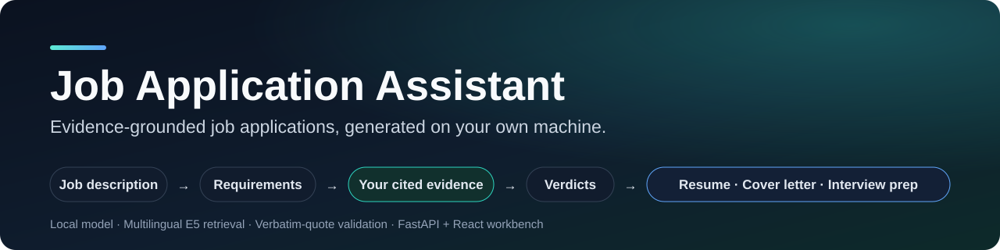
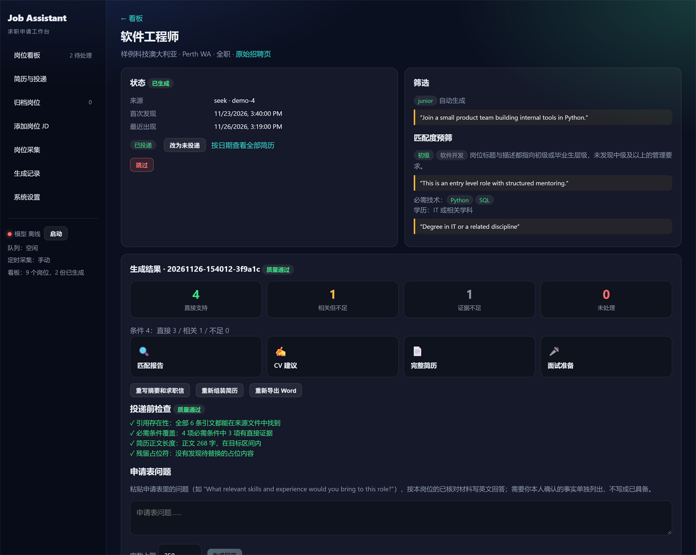
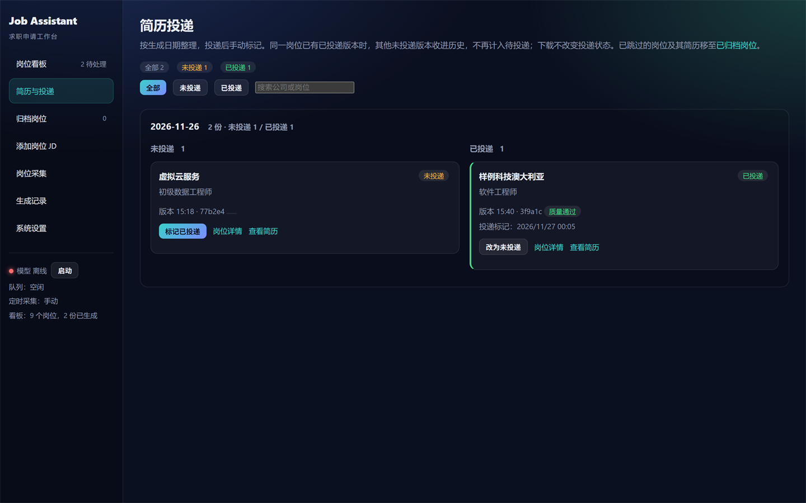
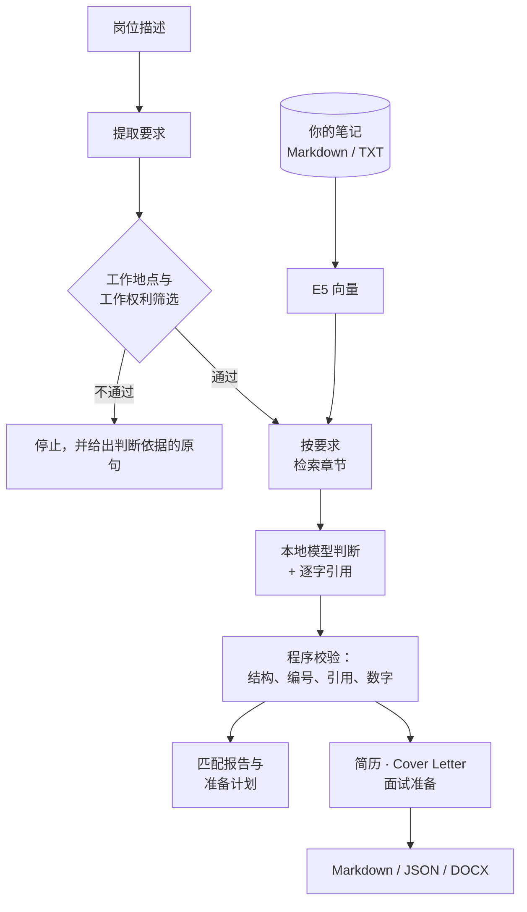

<div align="center">



<p>
  <a href="https://github.com/Maxwell2048/job-application-assistant/actions/workflows/tests.yml"></a>
  <a href="LICENSE"></a>
  
  
  
  
  
</p>

<p><b>每一句话，都能追溯到你亲手写下的原文。</b><br>
给它一份岗位描述和你自己的项目记录，<br>
得到匹配报告、准备计划、定制简历、Cover Letter 和面试准备，每一条都附带逐字引用的证据。</p>

<p>
  <a href="#-快速开始"><b>快速开始</b></a> ·
  <a href="#-工作原理"><b>工作原理</b></a> ·
  <a href="#-界面截图"><b>界面截图</b></a> ·
  <a href="#-文档"><b>文档</b></a> ·
  <a href="README.md"><b>English</b></a>
</p>


<sub>岗位看板，使用虚构的演示数据。界面和生成的报告以中文为主；你的经历材料和岗位描述可以是中文或英文。</sub>

</div>

<br>

## 🤔 为什么要做这个

AI 简历生成器常常凭空写出自信的句子，这个项目拒绝这样做。它从**你自己的**项目记录里检索证据，让本地模型逐条判断每项岗位要求，并**拒绝任何在原文里找不到的引用**。

| | 常见的 AI 简历生成器 | Job Application Assistant |
|---|---|---|
| 内容从哪来 | 模型怎么写就是什么 | 从你的笔记中检索，逐字引用 |
| 编造的数字或工具 | 直接进了简历 | 被程序校验拦下并重试 |
| 团队成果 | 经常被写成"我搭建了……" | 区分个人和团队章节，只引用团队章节的内容会被拒绝 |
| 你达不到的要求 | 被含糊带过 | 标为 `insufficient`，列入需要准备的缺口 |
| 你的数据 | 发送到云端 API | 留在本机，模型通过本地回环地址运行 |
| 你能核对什么 | 只有最终文本 | 每一行都能回到它出自的章节和原句 |

> [!NOTE]
> 检索相似度不是录用概率，缺少证据也不代表你不会这项技能。所有生成的文档都是草稿，发送前需要你自己审阅。

## ✨ 亮点

<table>
<tr>
<td width="50%" valign="top">

### 🔎 证据检索
用多语言 E5 模型检索你自己的 Markdown 和文本笔记。切块保留标题位置，所以每条引用都能指回它出自的段落。

</td>
<td width="50%" valign="top">

### ⚖️ 逐条判断
每项要求给出 `direct`、`related` 或 `insufficient`，并附逐字原句。处理失败会记为失败，而不会被当作"没有证据"。

</td>
</tr>
<tr>
<td valign="top">

### 📝 有据可依的写作
定制简历、Cover Letter、面试问题、STAR 回答和申请表问题的回答，只能使用证据支持的内容。

</td>
<td valign="top">

### 🧭 先筛选，再花时间
工作地点与工作权利筛选、岗位级别与匹配度检查、仅限在校生识别，以及六类岗位划分。不合适的岗位会尽早停下，并附上做出判断的原句。

</td>
</tr>
<tr>
<td valign="top">

### 🖥️ 一个工作台，而不只是脚本
FastAPI + React 看板：实时阶段进度、手动提交 JD、定时采集、运行历史、发送前质量报告和简历版本追踪。

</td>
<td valign="top">

### 🔒 隐私优先
连接本地、兼容 OpenAI 接口的模型。没有云端回退；因为提示词里有你的原始材料，系统会拒绝开启 LangSmith 追踪。

</td>
</tr>
</table>

## 📸 界面截图

所有截图都使用虚构的演示数据，不包含真实岗位或个人材料。

<table>
<tr>
<td width="50%"></td>
<td width="50%"></td>
</tr>
<tr>
<td><b>已生成的岗位。</b>筛选原句、各项要求的判断计数、生成的文档、发送前质量检查和申请问题输入框。</td>
<td><b>简历追踪。</b>按日期分组的版本，每个版本有自己的投递状态。下载文件不会自动标记为已投递。</td>
</tr>
</table>

## 🚀 快速开始

你需要 **Python 3.12**（CI 也会测试 3.13）、构建前端时用一次的 **Node 22**，以及一个提供 OpenAI 兼容接口 `/v1/chat/completions` 的**本地模型服务**（例如 llama.cpp 或 Ollama）。

```powershell
git clone https://github.com/Maxwell2048/job-application-assistant.git
cd job-application-assistant
Copy-Item config.local.example.json config.local.json   # 填写 "model" 和 "base_url"
.\start.bat                                             # 打开 http://127.0.0.1:8000
```

`start.bat` 会创建虚拟环境、安装后端依赖、首次构建前端、执行数据库迁移并打开看板。它不会启动你的模型服务：请自己启动，或者把 `RAG_MODEL_LAUNCHER` 设为启动模型的脚本，然后点看板上的 **启动** 按钮。把你当前的简历放在 `resume/base_resume.docx`。

<details>
<summary><b>更喜欢命令行？先用虚构示例试一次</b></summary>

```powershell
py -3.12 -m venv .venv
.\.venv\Scripts\python.exe -m pip install -r requirements.txt
.\.venv\Scripts\python.exe search_experience.py --data examples/experiences --check
.\.venv\Scripts\python.exe match_job.py --jd examples\junior_developer_jd.txt --data examples/experiences --config config.local.json --top-k 3
```

`examples/experiences/demo_project.md` 是虚构的，不能用作真实的申请证据。`--check` 只读取文件，不加载模型。第一次真正检索时会下载 E5 权重（470 MB），缓存后可以加 `--offline`。

| | 网页应用 | 命令行 |
|---|---|---|
| 运行匹配流程 | ✅ 提交页面 | ✅ `match_job.py` |
| 采集和筛选岗位 | ✅ 自动采集 | ✅ `-m backend.app.autopilot tick` |
| 追踪简历版本和投递 | ✅ | ❌ |
| 静态报告查看页 | ✅ 内置 | ✅ `build_site.py` |
| 可脚本化、批量处理 | 部分 | ✅ |

</details>

<details>
<summary><b>环境要求和磁盘占用</b></summary>

| 项目 | 说明 |
|---|---|
| Python | 测试使用 3.12，CI 另测 3.13 |
| Node | 22，只在构建前端时需要 |
| 模型 | 任何兼容 OpenAI 接口的服务；本仓库不附带、也不训练模型 |
| 虚拟环境 | 约 1.2 GB |
| `intfloat/multilingual-e5-small` | 470 MB，在 CPU 上运行 |
| 前端依赖 | 构建时 84 MB；构建产物 299 KB |

</details>

## 🧠 工作原理



**判断结果长什么样。** `examples/` 里的虚构示例要求 Flask、SQL 连接查询、Git、Docker 和自动化测试。示例经历文件提到了前三项，没有提到后两项，所以一次运行应当得到这样的结果：

| 要求 | 判断 | 证据 |
|---|---|---|
| 用 Flask 开发 Python Web 应用 | `direct` | "我负责使用 Python 和 Flask 实现预约创建与取消接口。"（`demo_project.md` › 后端开发） |
| SQL 连接查询与参数化查询 | `direct` | "我编写 SQL JOIN 查询，关联预约记录与房间信息，并用参数化查询处理输入。" |
| Git 与 Pull Request | `direct` | "我与三位组员通过 Git 分支和 Pull Request 协作。" |
| Docker（优先） | `insufficient` | 没有章节提到；列为需要准备的内容，不会被写进材料 |
| 自动化测试（优先） | `insufficient` | 同上 |

*此表用虚构示例说明报告格式；你的实际判断以你自己的模型运行结果为准。*

<details>
<summary><b>八个阶段详解</b></summary>

| 阶段 | 做什么 |
|---|---|
| 1. 提取 | 把 JD 变成结构化要求：必需还是优先、限定条件、AND/OR 关系。 |
| 2. 筛选 | 检索前先筛查工作地点和工作权利。必须在西澳以外现场工作、又没有西澳或可在西澳远程选项的岗位，会让流程停止（退出码 3）。 |
| 3. 检索 | E5 的 query/passage 前缀、归一化向量点积、320 token 窗口、40 token 重叠，按章节去重，返回完整的原始段落。 |
| 4. 判断 | 每项要求一个判断，附逐字引用。处理失败与证据不足是两种不同状态。 |
| 5. 校验 | 写入任何内容之前，由程序检查 JSON 结构、要求编号、候选编号和引用是否存在于原文。 |
| 6. 总结 | 优势、证据缺口，以及带完成标准、排好优先级的练习计划。 |
| 7. 起草 | CV 建议、Cover Letter、简历组装、面试问题和 STAR 准备。 |
| 8. 导出 | Word 文档，发送前在办公软件里预览。 |

当文档遵循项目模板时，检索优先选择"本人贡献"章节，而不是派生的 CV/STAR 表述。向量保存在内存中，没有持久化的向量数据库或向量缓存。后端默认用 LangGraph 状态图运行各阶段；`RAG_GENERATION_ENGINE=classic` 用普通 Python 流程运行相同阶段，对比测试要求两者结果完全一致（见 [docs/langchain-langgraph.md](docs/langchain-langgraph.md)）。

</details>

## 📊 数据一览

<table>
<tr>
<td align="center"><b>518</b><br><sub>项 Python 测试</sub></td>
<td align="center"><b>12</b><br><sub>项前端测试</sub></td>
<td align="center"><b>2 系统 × 2 Python</b><br><sub>CI 矩阵</sub></td>
<td align="center"><b>27</b><br><sub>个 API 接口</sub></td>
<td align="center"><b>14</b><br><sub>个命令行工具</sub></td>
<td align="center"><b>13 倍</b><br><sub>5,000 个岗位时看板提速</sub></td>
</tr>
</table>

- **测试：** 引擎与命令行 339 项、后端 API 132 项、采集器 47 项，全部使用合成数据；CI 还会运行前端测试和生产构建。
- **规模：** 5,000 个岗位、1,500 次运行时，看板从 5.7 秒、11,506 条 SQL 降到 0.43 秒、32 条 SQL，靠的是批量加载和按目录签名缓存的运行摘要。详见 [docs/performance.md](docs/performance.md)，可用 `tools/perf/bench_list_api.py` 复现。

## 🏗️ 技术栈

| 层 | 技术 |
|---|---|
| 检索 | `sentence-transformers`、`intfloat/multilingual-e5-small`，可选 LangChain `InMemoryVectorStore` |
| 模型接入 | 任何兼容 OpenAI 接口的本地服务（llama.cpp、Ollama 等），通过 HTTP 或 LangChain `ChatOpenAI`；JSON Schema 输出，重试次数有上限 |
| 流程编排 | 带检查点的 LangGraph 状态图，或普通 Python 流程 |
| 后端 | FastAPI、SQLAlchemy、Alembic、SQLite 或 PostgreSQL、服务器推送事件（SSE） |
| 前端 | React、TypeScript、Vite |
| 文档 | python-docx 导出，文件名为以公司开头的英文名 |
| 交付 | GitHub Actions（Ubuntu 和 Windows）；`compose.yaml` 提供 PostgreSQL、API 和 nginx |

## 🗺️ 路线图

- [x] 证据检索、逐条判断和逐字引用校验
- [x] 有据可依的简历、Cover Letter、面试和申请问题回答
- [x] 带采集、筛选、排队和简历追踪的网页工作台
- [x] 用开关接入 LangChain 和 LangGraph，并有对比测试
- [x] 运行记录越来越多时列表依然很快
- [ ] 更大的合成公开评测集
- [ ] 更强的检查：引用是否真正支持它所支撑的说法
- [ ] 持久化的向量缓存
- [ ] 更广泛的平台和模型兼容性测试

未勾选的是计划中的改进，不是当前的保证。

## 📖 参考

<details>
<summary><b>网页页面</b></summary>

| 页面 | 做什么 |
|---|---|
| 看板 | 按状态列出所有岗位，显示筛选结论、原句和"可投"一栏。初级岗位在前，中级和高级岗位折叠在下方。 |
| 岗位 | 实时阶段进度、渲染后的文档、Word 下载，以及弹窗里的地点筛选依据。 |
| 提交 | 手动粘贴 JD 并立即运行。中止粘贴 JD 的任务会删除未完成的运行目录和保存的 JD 文件。 |
| 自动采集 | 手动采集、模式切换、状态和历史。 |
| 生成记录 | 运行历史，只读。 |
| 简历 | 按日期分组的生成版本，每个版本有自己的投递状态。 |
| 设置 | 当前生效配置，只读。 |

进度通过服务器推送事件更新。因为本地模型只有一个处理槽位，同一时间只运行一个生成任务。

</details>

<details>
<summary><b>命令行流程</b></summary>

把 `YOUR_RUN_DIRECTORY` 换成匹配命令输出的目录：

```powershell
$runDir = 'outputs\YOUR_RUN_DIRECTORY'

# 不重新检索，只重新生成准备总结
.\.venv\Scripts\python.exe job_summary.py --run $runDir --config config.local.json

# 生成申请材料草稿并组装简历
.\.venv\Scripts\python.exe tailor_cv.py --run $runDir --resume resume\base_resume.docx --config config.local.json
.\.venv\Scripts\python.exe build_resume.py --run $runDir --resume resume\base_resume.docx --config config.local.json

# 发送前检查质量，然后导出并准备面试
.\.venv\Scripts\python.exe quality_report.py --run $runDir
.\.venv\Scripts\python.exe job_identity.py --run $runDir --config config.local.json   # 文件名所用的公司和职位
.\.venv\Scripts\python.exe export_docx.py --run $runDir --letter
.\.venv\Scripts\python.exe interview_prep.py --run $runDir --config config.local.json

# 刷新静态查看页
.\.venv\Scripts\python.exe build_site.py
```

从剪贴板、文件或标准输入保存一份 JD：

```powershell
.\.venv\Scripts\python.exe add_jd.py
.\.venv\Scripts\python.exe add_jd.py --file draft.txt
.\.venv\Scripts\python.exe add_jd.py --stdin
```

`match_job.py` 的退出码：匹配阶段完成为 `0`，处理失败或部分完成为 `1`，参数无效为 `2`，被地点筛选拦下为 `3`。`tailor_cv.py`、`interview_prep.py` 和 `build_resume.py` 完成时返回 `0`，部分输出或生成失败返回 `1`，输入不可用、什么都没写入时返回 `2`。可选的总结步骤有单独的状态。

</details>

<details>
<summary><b>一次运行的输出</b></summary>

匹配会创建 `outputs/<时间戳>-<后缀>/`：

| 文件 | 内容 |
|---|---|
| `jd.txt` | 用于定位原文的规范化 JD |
| `requirements.json` | 要求、限定条件、关系和提取失败记录 |
| `matches.json` | 判断结果和证据引用 |
| `job_summary.json` | 准备建议，或总结失败的详情 |
| `report.md` | 匹配报告和准备总结 |
| `run_meta.json` | 运行状态、输入哈希、模型设置和错误 |
| `cv_suggestions.*` | 可选的 CV 建议和 Cover Letter 草稿 |
| `resume_tailored.*` | 可选的组装简历（Markdown 和 JSON） |
| `job_identity.json` | 可选的招聘公司和职位，每项都核对过确实是 JD 中的措辞 |
| `<Name>_Resume_<Company>_<Job-Title>_<MMDD-HHMM>.docx`、`<Name>_Cover_Letter_…docx` | 可选的 Word 导出，纯英文文件名，以公司开头；`--label` 可替换公司部分 |
| `interview_prep.*` | 可选的面试准备 |

只做提取的运行只生成提取相关的文件。后续生成可能产生带编号的新版本。重新生成总结会更新 `report.md` 和 `job_summary.json`；Word 导出可能替换所选 Markdown 对应的 DOCX。

</details>

<details>
<summary><b>配置：<code>config.local.json</code></b></summary>

从示例复制，永远不要提交：

| 字段 | 含义 |
| --- | --- |
| `model` | 你的服务接受的模型名 |
| `base_url` | 本地接口地址，例如 `http://127.0.0.1:1234/v1` |
| `api_key` | 本地服务需要时填写的凭据；不要提交真实凭据 |
| `context_budget` | 模型上下文窗口（token） |
| `max_output_tokens` | 预留的输出 token，必须小于上下文窗口 |
| `chars_per_token` | 估算输入预算用的换算系数，不是精确分词 |
| `timeout_seconds` | 单次请求超时 |
| `response_format` | `json_object`、`json_schema` 或 `none`，取决于服务支持 |
| `extra_body` | 可选的服务特定请求参数 |
| `local_model_endpoints` | 可选，按顺序尝试的本地端点列表，每项为 `{"base_url": ..., "model": ...}`；使用第一个在 `/v1/models` 中报告已加载列表中模型的端点。同一端口上不同引擎报告的名字不同时，加 `"models": [...]` |
| `adapter` | `openai_http`（普通 HTTP）或 `langchain_openai`（同样的请求经 LangChain 的 `ChatOpenAI` 发送；结构校验、引用校验和重试不变）。必须关闭 LangSmith 追踪，因为提示词里有你的原始材料 |
| `retriever` | `native`（默认）或 `langchain`（同样的 E5 切块放进 LangChain `InMemoryVectorStore`，排序相同） |

示例里有一项针对特定模型的思考模式设置；如果你的服务不支持，请删除或调整。没有自动的云端回退：配置的端点会收到你的个人原始材料，如需本地处理请保持在本机。

</details>

<details>
<summary><b>后端设置：<code>RAG_*</code> 环境变量</b></summary>

每项后端设置都是带 `RAG_` 前缀的环境变量，也可以写在根目录的 `.env` 文件里：

| 变量 | 默认值 | 用途 |
|---|---|---|
| `RAG_DATABASE_URL` | `sqlite:///state/rag.sqlite` | 数据库 |
| `RAG_HOST` / `RAG_PORT` | `127.0.0.1` / `8000` | 监听地址 |
| `RAG_OUTPUTS_DIR` | `outputs/` | 运行结果的保存位置 |
| `RAG_COLLECTOR_DIR` | 未设置 | SEEK 采集器缓存、分页游标和采集结果的私有运行目录 |
| `RAG_GENERATION_ENGINE` | `langgraph` | `langgraph` 或 `classic` |
| `RAG_AUTOPILOT_ENABLED` | `false` | 启动时开启定时采集 |
| `RAG_ALLOW_REMOTE` | `true` | 接受允许在西澳远程工作的全国远程岗位 |

</details>

<details>
<summary><b>部署：本机、容器和数据库</b></summary>

在 Windows 上，`start.bat` 包含整个流程。手动的等价步骤：

```powershell
.\.venv\Scripts\python.exe -m pip install -r requirements-backend.txt
Push-Location frontend
npm ci
npm run build
Pop-Location
.\.venv\Scripts\python.exe -m backend.app.main        # 接口文档在 /docs；换端口加 --port 8010
```

`compose.yaml` 提供 PostgreSQL、API 和 nginx 前端。模型推理留在主机上；从示例创建 `config.docker.json` 并指向主机上的端点。发布的端口只绑定本地回环地址。应用没有登录认证，只供本机使用；仓库提供容器配置，但不声称已验证云端部署或生产运维。

默认用 SQLite 作为单机数据库，位于 `state/rag.sqlite`；设置 `RAG_DATABASE_URL` 可改用 PostgreSQL。数据库结构变更通过 Alembic 迁移：

```powershell
.\.venv\Scripts\python.exe -m alembic -c backend/alembic.ini upgrade head
```

升级已有数据库前请先备份。看板和简历列表从 `run_summary_cache` 读取缓存的运行摘要，只有运行目录里的文件变化时才重新生成；这张表只存派生数据，可以随时删除。

</details>

<details>
<summary><b>测试</b></summary>

CI 在 Ubuntu 和 Windows、Python 3.12 和 3.13 上运行合成数据的引擎测试和后端 API 测试，运行不访问网络的采集器测试，以及前端回归测试和生产构建。前端测试覆盖分组、可见性和刷新逻辑；不声称有浏览器端到端测试。

```powershell
python -X utf8 -m unittest discover -s tests -v
python -X utf8 -m unittest discover -s backend/tests -t . -v
python -X utf8 -m unittest discover -s tools/seek_collector -p "test_*.py" -q
Push-Location frontend
npm ci
npm test
npm run build
Pop-Location
```

```powershell
# 小型公开冒烟评测：四项虚构要求，其中三项有召回目标
.\.venv\Scripts\python.exe tests/run_eval.py
.\.venv\Scripts\python.exe tests/run_eval.py --offline    # 向量模型缓存后
.\.venv\Scripts\python.exe tests/run_eval.py --config config.local.json   # 可选的本地模型评测
```

默认评测使用 `examples/experiences/` 和 `tests/public_eval_set.json`。它只是冒烟检查，不是模型准确率基准。模拟测试验证的是软件行为，不是求职结果。

</details>

<details>
<summary><b>项目结构</b></summary>

```text
根目录模块（24 个）
  search_experience.py     材料读取与可复用的 E5 检索
  jd_parser.py             JD 提取与原文定位
  location_gate.py         西澳工作权利筛选
  evidence_matcher.py      证据判断与引用校验
  local_llm.py             模型适配、结构校验、有上限的重试
  langchain_client.py      可选的 LangChain 对话适配器
  langchain_retrieval.py   可选的 LangChain 向量库检索器
  match_job.py             匹配流程
  job_family.py            JD 的岗位类别（标题与侧重）
  job_identity.py          招聘公司和职位，用于导出文件名
  job_summary.py           优势、缺口和准备建议
  report_writer.py         匹配报告
  tailor_cv.py             申请材料起草
  build_resume.py          简历组装
  resume_review.py         按岗位重排已有项目块
  resume_skills.py         经本人确认的技能展示规则
  quality_report.py        发送前质量报告，不调用模型
  application_answer.py    回答申请表问题
  export_docx.py           Word 导出
  interview_prep.py        面试与 STAR 准备
  add_jd.py                从剪贴板、文件或标准输入保存 JD
  build_site.py            静态报告查看页
  import_uwa_kb.py         可选：导入课程项目知识库
  make_public_release.py   生成只含源码的发布副本并扫描

backend/                   FastAPI 接口、数据库（SQLAlchemy + Alembic）、任务队列、自动采集
frontend/                  React + TypeScript 应用（Vite）
tools/seek_collector/      SEEK 采集、筛选通道、拒绝访问处理
tools/perf/                列表接口的规模基准测试
docs/                      设计文档
examples/                  虚构的演示输入
tests/                     回归与评测工具
compose.yaml               PostgreSQL + API + nginx 前端
```

`import_uwa_kb.py` 是针对原课程项目知识库格式的可选导入器，一般使用不需要它。

</details>

## 📚 文档

| 文档 | 内容 |
|---|---|
| [docs/application-workflow.md](docs/application-workflow.md) | 配置、筛选行为和申请流程 |
| [docs/langchain-langgraph.md](docs/langchain-langgraph.md) | 三个开关、状态图，以及如何验证两种实现等价 |
| [docs/performance.md](docs/performance.md) | 列表为什么变慢、测量结果、如何重跑基准测试 |
| [docs/jd_matcher_spec.md](docs/jd_matcher_spec.md) | 匹配规格：输入、阶段、输出和保证 |
| [CHANGELOG.md](CHANGELOG.md) | 按日期记录的变更，附提交和 PR 链接 |

## ❓ 常见问题

<details>
<summary><b>连不上模型端点。</b></summary>

先单独访问 `http://127.0.0.1:<端口>/v1/models` 检查服务，确认 `base_url` 包含 `/v1`，并把完整地址写进 `config.local.json`。设置了 `local_model_endpoints` 时，应用会按顺序尝试，使用第一个报告已加载模型的端点。只有当 `RAG_MODEL_LAUNCHER` 指向启动模型的脚本时，**启动** 按钮才有用。

</details>

<details>
<summary><b>8000 端口被占用了。</b></summary>

换一个端口启动：`.\.venv\Scripts\python.exe -m backend.app.main --port 8010`，然后打开 `http://127.0.0.1:8010`。

</details>

<details>
<summary><b>第一次运行很慢，还在占用网络。</b></summary>

第一次检索会下载 E5 权重（470 MB）。之后在命令行加 `--offline`，或保留缓存让应用直接使用。离线机器需要事先准备好模型缓存。

</details>

<details>
<summary><b>Word 文件和预览看起来不一样。</b></summary>

外观取决于安装的字体和办公软件。请在你实际发送的那台电脑上预览导出结果。

</details>

<details>
<summary><b>我的材料会离开这台电脑吗？</b></summary>

只有你配置的端点会收到原始材料。保持在本地回环地址，就不会有任何内容离开本机。出于同样的原因，系统会拒绝开启 LangSmith 追踪。

</details>

## ⚠️ 局限

- 这是供一个人使用的本地原型，不是生产级多用户服务。
- 引用本身正确，也可能被误读；申请材料里的说法需要人工审阅。
- Top-K 检索可能漏掉证据或返回较弱的候选；相似度只用于排序。
- 上下文规划使用字符预算估算，不是精确的模型 token 数。
- 数字校验只能确认数字出现在原文中，不能确认实验结论被正确解读。
- DOCX 外观取决于字体和办公软件。
- 原始材料的质量，以及个人和团队贡献的边界，会影响每一个生成结果。
- 系统使用预训练模型，不训练也不微调模型。
- 采集器不保证能访问第三方岗位列表，遇到拒绝访问或限流时会停止。

## 🔐 数据处理与公开发布

请把个人经历、简历、凭据、JD、生成的申请材料、截图和材料核对笔记保持私有。公开示例必须是虚构的，或经过明确同意。

这个应用是在一个更大的个人工作区里开发的。忽略规则只能阻止私有目录被**新**加入 Git，不能移除已跟踪的文件或抹掉旧提交。发布前请单独准备并审阅一份只含源码的发布副本。

`make_public_release.py --out <目录>` 把白名单内的文件复制到一个新目录或空目录。它从不覆盖或删除已有文件，不支持 `--clean`。每个复制的文本文件（包括发布脚本本身）都会扫描常见的密钥格式。对于个人标识信息，可以用 `--private-patterns <私有文件.json>` 提供一个正则表达式数组，这个文件存放在发布目录之外，不会被复制。自动检查无法发现所有个人信息，请在独立的 Git 仓库发布前人工审阅输出。请排除 `config.local.json`、`experiences/`、`resume/`、`_sources/`、`_review/`、`jobs/`、`outputs/` 和 `site/`。

## 🤝 参与贡献

报告问题时，请附上最小的虚构输入、所用命令、平台和 Python 版本，以及不含凭据的模型配置。不要附上私人简历或原始的个人输出。

提交 PR 时，请说明用户能看到的变化，补充有意义的回归测试，并运行相关测试。保持检索、模型接入、校验和渲染彼此分离。排版预览请使用合成内容。

## 📄 许可证

MIT 许可证，见 [LICENSE](LICENSE)。模型和依赖库的许可证各自独立。

<div align="center"><sub>为宁愿少投几份、但每份都真实的求职者而做。</sub></div>
