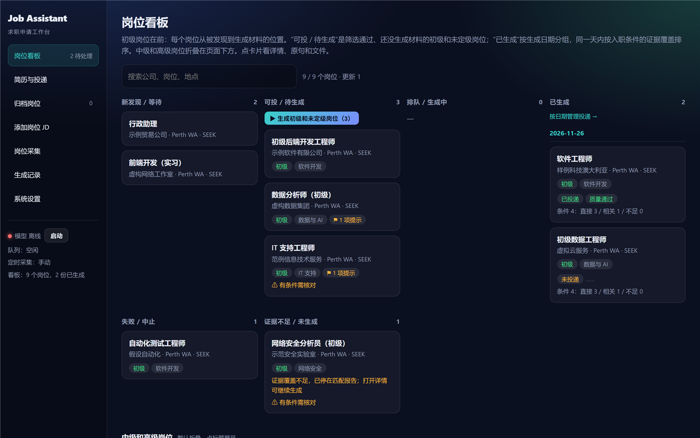
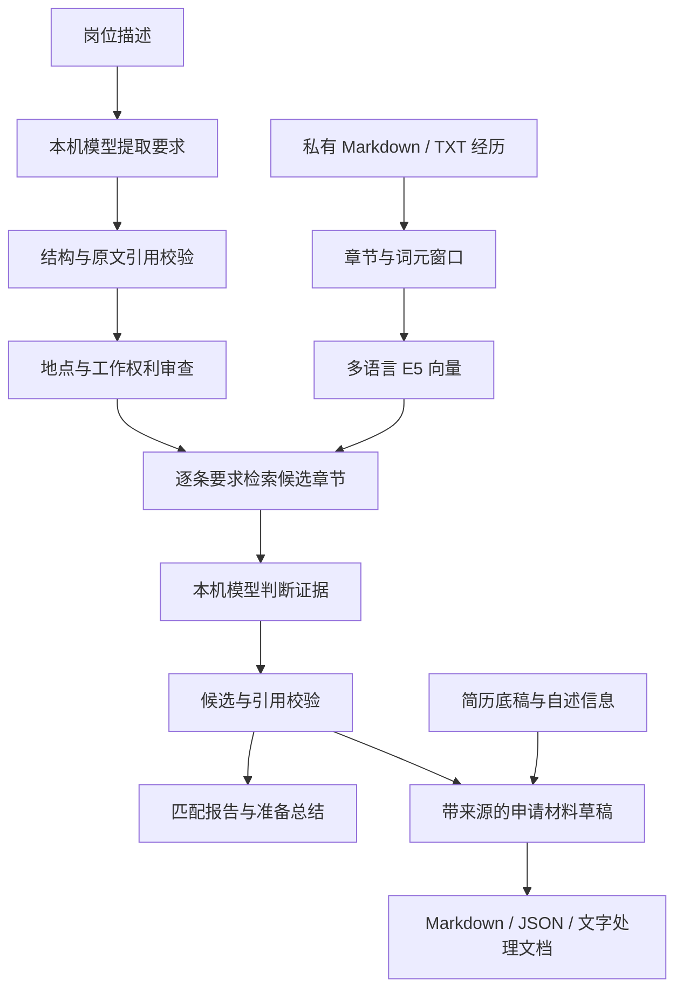

# 求职申请助手

[English](README.md) | **简体中文**

> 给它一份岗位描述和你自己的项目记录，换回一份带证据链接的匹配报告、一份准备计划、简历修改建议、一封求职信、一份组装好的简历和一套面试准备——每一句结论都能追回到你亲手写过的那一行。

**24 个根模块** · 14 个命令行工具 · 27 个后端接口 · 7 个页面 · **518 个测试用例** · `FastAPI` + `React` · `SQLite` 或 `PostgreSQL`

界面与生成的报告使用中文；你的原始材料和岗位描述可以是中文或英文。

---

## 这是什么

大多数简历生成工具会凭空写出自信的句子。这个工具拒绝这么做。它只从你自己项目记录的私有素材库里检索，让本机模型逐条判断岗位要求与检索到的原文是否匹配，并且拒收任何不是原样出现在素材里的引文。

四层结构：

- **素材层**——你的笔记、简历和自述事实，按标题切分，用多语言 E5 模型编码。章节位置保留下来，所以每条引用都能指回它出自哪一段。
- **判断层**——每条岗位要求给一个结论：`direct`（直接支持）、`related`（相关但不足）、`insufficient`（证据不足），每条都钉在一句原文上。处理失败单独记录为失败，绝不混同于"没有证据"。
- **生成层**——求职准备总结、简历修改建议、求职信、组装简历、面试问题与行为面试四步回答。这些内容只能用素材层支持得住的东西。
- **工作台**——一个本机网页看板，负责采集岗位、按你的地点与工作权利筛选、排队生成，并记录你到底把哪一版简历投到了哪一家。

它是给一个人用的本机原型，不是录用预测器：

> 检索相似度不是录用概率。缺少证据不代表你不具备某项技能。生成的每一份材料都是供人工审阅的草稿。

## 界面长什么样

下面三张图全部跑在虚构的演示数据上：没有真实岗位，也没有任何个人材料。



岗位看板：每个岗位按状态排列，卡面显示筛选结论、判定出的级别与岗位族，以及必需条件中有几条拿到了直接证据。


生成后的岗位页：筛选依据的原句、逐条判断的计数、产出的文档、发送前质检结果，以及申请表问答输入框。


简历按生成日期分组，每一版独立记录投递状态。下载文件不会把版本标成已投递。

## 快速开始

开始前先确认这几项：

| 要求 | 说明 |
|---|---|
| `Python 3.12` | 实测可用的解释器，持续集成同时覆盖 3.13。 |
| `Node 22` | 只在构建前端时需要一次。 |
| 一个本机模型服务 | 任何提供 OpenAI 兼容 `/v1/chat/completions` 的服务都可以，默认不使用也不需要云端账号。 |
| 约 2 GB 空闲磁盘 | 虚拟环境实测约 1.2 GB，E5 权重 470 MB，加前端构建产物。 |
| 你的简历放在 `resume/base_resume.docx` | 网页应用与简历组装步骤都会读它。 |

### 方案一——用网页应用（推荐）

```powershell
git clone https://github.com/Maxwell2048/job-application-assistant.git
cd job-application-assistant
Copy-Item config.local.example.json config.local.json   # 再填入模型名与接口地址
.\start.bat
```

`start.bat` 会创建虚拟环境、安装后端依赖、构建一次前端、执行数据库迁移，然后打开 `http://127.0.0.1:8000`。它不负责启动你的模型服务：请单独启动，或者把 `RAG_MODEL_LAUNCHER` 指向一个启动脚本，再用看板上的**启动**按钮。

### 方案二——用命令行

```powershell
py -3.12 -m venv .venv
.\.venv\Scripts\python.exe -m pip install -r requirements.txt
```

先用虚构样例练手，再碰真实材料：

```powershell
.\.venv\Scripts\python.exe search_experience.py --data examples/experiences --check
.\.venv\Scripts\python.exe match_job.py --jd examples\junior_developer_jd.txt --data examples/experiences --config config.local.json --top-k 3
```

`examples/experiences/demo_project.md` 是虚构内容，不能当作真实的申请证据。`--check` 只读文件、不加载模型。第一次真正检索会下载 E5 权重；缓存之后加 `--offline` 即可离线运行。

### 两条路径各给你什么

| | 网页应用 | 命令行 |
|---|---|---|
| 跑匹配流程 | ✅ 手动提交页 | ✅ `match_job.py` |
| 采集与筛选岗位 | ✅ 自动处理 | ✅ `-m backend.app.autopilot tick` |
| 记录简历版本与投递状态 | ✅ | ❌ |
| 静态报告查看页面 | ✅ 内置 | ✅ `build_site.py` |
| 可脚本化、可批处理 | 部分 | ✅ |

## 工作原理



| 阶段 | 做什么 |
|---|---|
| 一、提取 | 把岗位描述拆成结构化要求：必需与优先、限定条件、并列与取舍关系。 |
| 二、审查 | 在检索之前先审地点与工作权利。岗位明确要求在西澳之外现场办公、又没有西澳办公或从西澳远程的选项时，流程立即中止（退出码 3）。 |
| 三、检索 | 使用 E5 的查询与段落前缀、归一化向量点积；长章节按 320 词元分窗、重叠 40 词元；按章节去重，返回完整原始段落。 |
| 四、判断 | 逐条要求给一个结论并附原样引文。处理失败与"证据不足"是两个不同状态。 |
| 五、校验 | 写入任何文件之前，程序化校验结构、要求编号、候选编号与引用是否确实存在。 |
| 六、总结 | 优势、证据缺口、按优先级排列的补学练习与完成标准。 |
| 七、起草 | 简历修改建议、求职信、简历组装、面试问题与行为面试四步准备。 |
| 八、导出 | 文字处理文档，发送前先在你自己的办公软件里预览。 |

文档遵循项目模板时，检索会优先采用"个人贡献"章节，而不是由此派生出的简历措辞。向量只保存在内存里，没有持久化的向量库，也不缓存向量。

## 功能一览

| 方面 | 你能得到什么 |
|---|---|
| 检索 | 对你自己写的 Markdown 与文本做多语言语义检索，保留章节位置。 |
| 判断 | 逐条要求的 `direct` / `related` / `insufficient` 结论，以及程序化引用校验。 |
| 筛选 | 地点与工作权利审查、匹配度闸门、仅限在读学生的岗位识别、硬性条件检查，六个岗位族：`security`、`ai`、`software`、`data`、`it`、`business`。 |
| 起草 | 准备总结、简历修改建议、求职信、简历组装、面试问题、行为面试回答、申请表问题回答。 |
| 质检 | 每次生成后出一份不调用模型的发送前质检报告：通过、值得一看、有问题。 |
| 网页应用 | `FastAPI` 后端加 `React` 前端：看板、带实时进度的岗位页、手动提交、自动处理、运行历史、简历投递记录、只读设置。 |
| 采集 | SEEK 采集器，含精准与广泛两种搜索范围、反爬拒绝处理、分页进度持久化。 |
| 存储 | 默认 `SQLite`，改一个环境变量即可换 `PostgreSQL`，迁移用 `Alembic`，运行摘要带缓存。 |
| 导出 | 简历与求职信导成文字处理文档，文件名全英文、公司在前。 |

## 部署

### 本机

在 Windows 上，`start.bat` 覆盖全部步骤。手动等价命令：

```powershell
.\.venv\Scripts\python.exe -m pip install -r requirements-backend.txt
Push-Location frontend
npm ci
npm run build
Pop-Location
.\.venv\Scripts\python.exe -m backend.app.main        # 接口文档在 /docs
```

需要换端口时：`.\.venv\Scripts\python.exe -m backend.app.main --port 8010`。

### 容器

`compose.yaml` 提供 `PostgreSQL`、后端接口和 `nginx` 前端。模型推理留在主机上；先照示例创建 `config.docker.json` 并指向主机地址。对外发布的端口绑定回环地址。应用没有身份认证，是给本机使用的。仓库提供容器配置，但不声称已经验证云端生产运行。

### 数据库

默认是单机数据库文件 `state/rag.sqlite`。把 `RAG_DATABASE_URL` 指向 `PostgreSQL` 即可切换。结构变更通过 `Alembic` 迁移：

```powershell
.\.venv\Scripts\python.exe -m alembic -c backend/alembic.ini upgrade head
```

升级旧数据库前先备份。看板与简历页读取 `run_summary_cache` 表里的运行摘要缓存，只有运行目录里的文件发生变化才重新生成，所以运行记录越积越多，列表也不会变慢。这张表只存派生数据，随时可以删除。详见 [docs/performance.md](docs/performance.md)。

## 使用

### 网页页面

| 页面 | 做什么 |
|---|---|
| 看板 | 按状态排列全部岗位，含筛选结论、支撑结论的原句，以及一列"待生成"。 |
| 岗位页 | 实时阶段进度、渲染后的文档、文档下载，地点审查依据以弹窗展示。 |
| 手动提交 | 粘贴一份岗位描述立即运行。中止粘贴发起的任务，会删除它未完成的运行目录和已保存的文件。 |
| 自动处理 | 手动采集轮次、模式切换、状态与历史。 |
| 运行历史 | 只读的历次运行记录。 |
| 简历 | 生成的版本按日期分组，每版独立记录已投递或未投递；下载文件不代表已投递。 |
| 设置 | 只读展示当前生效的配置。 |

进度通过服务器推送事件到达。本机模型只有一个槽，所以同一时间只跑一次生成。

### 命令行流程

把 `YOUR_RUN_DIRECTORY` 换成匹配命令打印出的运行目录：

```powershell
$runDir = 'outputs\YOUR_RUN_DIRECTORY'

# 不重跑检索，单独重新生成准备总结
.\.venv\Scripts\python.exe job_summary.py --run $runDir --config config.local.json

# 生成申请材料草稿并组装简历
.\.venv\Scripts\python.exe tailor_cv.py --run $runDir --resume resume\base_resume.docx --config config.local.json
.\.venv\Scripts\python.exe build_resume.py --run $runDir --resume resume\base_resume.docx --config config.local.json

# 发送前质检，然后导出文档并准备面试
.\.venv\Scripts\python.exe quality_report.py --run $runDir
.\.venv\Scripts\python.exe job_identity.py --run $runDir --config config.local.json   # 识别公司与职位，用于文件名
.\.venv\Scripts\python.exe export_docx.py --run $runDir --letter
.\.venv\Scripts\python.exe interview_prep.py --run $runDir --config config.local.json

# 刷新静态查看页面
.\.venv\Scripts\python.exe build_site.py
```

### 保存岗位描述

```powershell
# 分别从剪贴板、文件、标准输入读取
.\.venv\Scripts\python.exe add_jd.py
.\.venv\Scripts\python.exe add_jd.py --file draft.txt
.\.venv\Scripts\python.exe add_jd.py --stdin
```

### 输出文件

匹配会在 `outputs/<时间戳>-<后缀>/` 下创建：

| 文件 | 内容 |
|---|---|
| `jd.txt` | 规范化后用于原文定位的岗位描述 |
| `requirements.json` | 要求、限定条件、关系、提取失败记录 |
| `matches.json` | 判断结论与证据引用 |
| `job_summary.json` | 准备建议，或总结失败的详情 |
| `report.md` | 匹配报告与准备总结 |
| `run_meta.json` | 运行状态、输入哈希、模型设置、错误 |
| `cv_suggestions.*` | 可选：简历修改建议与求职信草稿 |
| `resume_tailored.*` | 可选：组装好的简历（Markdown 与 JSON） |
| `job_identity.json` | 可选：招聘公司与职位名称，程序校验二者都出自原文 |
| `<姓名>_Resume_<公司>_<职位>_<月日-时分>.docx`、`<姓名>_Cover_Letter_…docx` | 可选：导出的文档，文件名全英文、公司在前，多次投递不会混淆；`--label` 可手动指定公司部分 |
| `interview_prep.*` | 可选：面试准备 |

只做提取的运行只产生提取相关的子集。后续生成可能追加带编号的版本。重新生成总结会更新 `report.md` 与 `job_summary.json`；导出会替换与所选 Markdown 对应的那份文档。

### 退出码

`match_job.py`：`0` 匹配阶段完成，`1` 失败或部分完成，`2` 命令行参数无效，`3` 被地点审查拦下。`tailor_cv.py`、`interview_prep.py`、`build_resume.py`：`0` 完成，`1` 部分完成（文件已写出）或生成失败，`2` 输入有误且什么都没写。可选的总结有独立的状态。

## 配置

`config.local.json` 从示例复制而来，不进入版本库：

| 字段 | 含义 |
| --- | --- |
| `model` | 你的服务接受的模型标识 |
| `base_url` | 本机接口地址，例如 `http://127.0.0.1:1234/v1` |
| `api_key` | 本机服务的凭证（如需要）；不要提交真实凭证 |
| `context_budget` | 模型上下文窗口（词元） |
| `max_output_tokens` | 为输出预留的词元，必须小于上下文窗口 |
| `chars_per_token` | 输入预算的字符换算系数，是估算而非精确分词 |
| `timeout_seconds` | 单次请求超时 |
| `response_format` | `json_object`、`json_schema` 或 `none`，视服务端支持而定 |
| `extra_body` | 可选的服务端专有请求字段 |
| `local_model_endpoints` | 可选，按顺序尝试的本机端点列表，每项为 `{"base_url": ..., "model": ...}`；使用第一个在 `/v1/models` 里报告所列模型已加载的端点。同一端口上不同引擎对同一模型报告不同名字时，在该项里加 `"models": [...]` |
| `adapter` | `openai_http`（直接发请求）或 `langchain_openai`（同样的请求经 `LangChain` 的 `ChatOpenAI` 发送；结构校验、引用校验与重试不变）。必须关闭 `LangSmith` 追踪，因为提示词含个人材料 |
| `retriever` | `native`（默认）或 `langchain`（同样的 E5 片段放进 `LangChain` 的 `InMemoryVectorStore`，排序相同） |

后端默认把生成步骤作为 `LangGraph` 状态图运行（`RAG_GENERATION_ENGINE=langgraph`；`classic` 用普通 Python 依次运行同样的步骤）。说明见 [docs/langchain-langgraph.md](docs/langchain-langgraph.md)。

示例里带一个关闭特定模型"思考模式"的设置，你的服务不支持就删掉或改写。没有自动的云端回退：配置的接口会收到个人材料原文，需要本地处理就让它留在本机。

### 后端设置

后端每一项设置都可以用带 `RAG_` 前缀的环境变量覆盖，或者写进根目录的 `.env` 文件：

| 变量 | 默认值 | 用途 |
|---|---|---|
| `RAG_DATABASE_URL` | `sqlite:///state/rag.sqlite` | 记账数据库 |
| `RAG_HOST` / `RAG_PORT` | `127.0.0.1` / `8000` | 监听地址与端口 |
| `RAG_OUTPUTS_DIR` | `outputs/` | 运行结果写到哪里 |
| `RAG_COLLECTOR_DIR` | 未设置 | 采集器的私人运行目录，存放缓存、分页游标与采集结果 |
| `RAG_GENERATION_ENGINE` | `langgraph` | `langgraph` 或 `classic` |
| `RAG_AUTOPILOT_ENABLED` | `false` | 启动时是否开启定时采集 |
| `RAG_ALLOW_REMOTE` | `true` | 是否接受允许从西澳远程工作的全国岗位 |

## 测试

持续集成在 Ubuntu 与 Windows 上、用 `Python 3.12` 与 3.13 跑引擎测试与后端接口测试，跑不访问真实网络的采集器测试，以及前端回归测试与生产构建。前端测试目前只覆盖分组与可见性的纯逻辑，不声称已有浏览器端到端测试。

```powershell
python -X utf8 -m unittest discover -s tests -v
python -X utf8 -m unittest discover -s backend/tests -t . -v
python -X utf8 -m unittest discover -s tools/seek_collector -p "test_*.py" -q
Push-Location frontend
npm ci
npm test
npm run build
Pop-Location
```

合计 **518 个 Python 测试用例**：引擎与命令行 339 个、后端接口 132 个、采集器 47 个。仓库里的测试全部使用合成数据。

```powershell
# 小规模公开冒烟评测：四条虚构要求，其中三条带召回目标
.\.venv\Scripts\python.exe tests/run_eval.py
.\.venv\Scripts\python.exe tests/run_eval.py --offline    # 向量模型缓存之后
.\.venv\Scripts\python.exe tests/run_eval.py --config config.local.json   # 可选：接本机模型评测
```

默认评测使用 `examples/experiences/` 与 `tests/public_eval_set.json`。它是冒烟检查，不是模型准确率基准。模拟测试验证的是程序行为，不代表求职成功率。

## 资源占用

以下为开发机上实测：

| 项目 | 占用 |
|---|---|
| 装好依赖的 `Python` 虚拟环境 | 约 1.2 GB |
| `intfloat/multilingual-e5-small` 权重 | 470 MB |
| 前端依赖（只在构建时需要） | 84 MB |
| 由后端直接提供的前端构建产物 | 299 KB |

向量计算在处理器上完成。生成阶段的内存与速度完全取决于你选的模型和推理服务；本仓库不附带也不训练模型。网页应用同一时间只跑一次生成，因为模型只有一个槽。记账数据库本身很小；`run_summary_cache` 表只存派生数据，随时可以删掉。

## 常见问题

**模型接口连不上怎么办？** 先单独访问 `http://127.0.0.1:<端口>/v1/models` 确认服务活着，再检查 `base_url` 是否带 `/v1`，最后确认 `config.local.json` 里填的是完整地址。如果配了 `local_model_endpoints`，程序会按顺序尝试每一项，用第一个报告模型已加载的端点。**启动**按钮只在 `RAG_MODEL_LAUNCHER` 指向真实启动脚本时才有用。

**8000 端口被占用了。** 换个端口启动：`.\.venv\Scripts\python.exe -m backend.app.main --port 8010`，然后打开 `http://127.0.0.1:8010`。

**第一次运行又慢又占网络。** 第一次检索要下载 470 MB 的 E5 权重。之后在命令行加 `--offline`，或者保留缓存让应用自己用。完全离线的机器需要预先放好模型缓存。

**导出的文档在别处打开字体变了。** 显示效果取决于本机字体与办公软件。请在你要发送的那台机器上预览。

**我的材料会不会离开这台机器？** 只有你配置的那个接口会收到原文。让它留在回环地址上，就什么都不外发。`LangSmith` 追踪被刻意拒绝，也是同一个理由。

## 数据处理与公开发布

个人经历、简历、凭证、岗位描述、生成的申请材料、截图和来源核对记录都应保持私有。公开示例必须是虚构的或经明确许可的。

本应用是在一个更大的个人工作区里开发的。忽略规则只阻止私有目录被**新**加入版本库，不会移除已跟踪的文件，也不会抹掉旧提交。写好这份说明不代表那个工作区及其历史适合发布。发布前请另行准备并审核一份只含源码的版本。

`make_public_release.py --out <目录>` 按白名单复制到新建或空目录，不覆盖也不删除已有文件，不支持 `--clean`。扫描覆盖包括发布脚本在内的全部复制文本文件，默认检查常见密钥格式。个人标识规则通过 `--private-patterns <私有文件.json>` 提供，格式是正则表达式字符串数组，须存放在发布目录之外且不会被复制。自动检查抓不全个人信息，发布前仍需人工审核，并使用独立版本库。

需要排除：`config.local.json`、`experiences/`、`resume/`、`_sources/`、`_review/`、`jobs/`、`outputs/`、`site/`。检查旧的设计文档里是否残留个人路径与示例。

## 局限

- 这是本机原型，不是可用于生产的多用户服务。
- 引用有效不代表理解正确；申请材料中的说法需要人工审阅。
- 召回条数有限，可能漏掉证据或返回弱候选。相似度只是排序信号。
- 上下文规划用字符预算估算，不是精确的词元计数。
- 数字校验只确认数字存在于来源中，不保证实验解释正确。
- 文档显示效果取决于字体与办公软件。
- 材料质量以及个人与团队归属的边界会影响每一份生成结果。
- 系统使用预训练模型，不做训练或微调。
- 采集器不保证能访问第三方网站，遇到拒绝访问或限流会停止。

## 项目结构

```text
根模块（24 个）
  search_experience.py     入库与可复用的 E5 检索
  jd_parser.py             岗位描述提取与原文定位
  location_gate.py         西澳工作权利审查
  evidence_matcher.py      证据判断与引用校验
  local_llm.py             模型适配层、结构校验、有限次重试
  langchain_client.py      可选的 LangChain 聊天适配
  langchain_retrieval.py   可选的 LangChain 向量检索适配
  match_job.py             匹配主流程
  job_family.py            判定岗位族（决定简历主打方向）
  job_identity.py          识别招聘公司与职位，用于导出命名
  job_summary.py           优势、缺口、准备建议
  report_writer.py         匹配报告
  tailor_cv.py             申请材料起草
  build_resume.py          简历组装
  resume_review.py         按岗位重排已有项目块
  resume_skills.py         候选人确认过的技能呈现规则
  quality_report.py        发送前质检，不调用模型
  application_answer.py    回答申请表问题
  export_docx.py           导出文字处理文档
  interview_prep.py        面试与行为面试准备
  add_jd.py                从剪贴板、文件或标准输入保存岗位描述
  build_site.py            静态报告查看页面
  import_uwa_kb.py         可选的旧课程项目知识库导入器
  make_public_release.py   生成只含源码的发布副本并扫描

backend/                   后端接口、记账（`SQLAlchemy` + `Alembic`）、任务执行、自动处理
frontend/                  `React` + 类型化脚本前端（`Vite`）
tools/seek_collector/      SEEK 采集、筛选范围、拒绝处理
tools/perf/                列表接口的规模基准
docs/                      设计说明（见下）
examples/                  虚构的演示输入
tests/                     回归测试与评测工具
compose.yaml               容器编排：数据库、接口、前端
```

`import_uwa_kb.py` 是针对原作者课程项目知识库格式的可选导入器，一般使用不需要它。

## 文档索引

| 文档 | 内容 |
|---|---|
| [docs/application-workflow.md](docs/application-workflow.md) | 配置、筛选行为、申请材料流程 |
| [docs/langchain-langgraph.md](docs/langchain-langgraph.md) | 三个开关、状态图、等价性如何验证 |
| [docs/performance.md](docs/performance.md) | 列表为什么变慢、实测数据、如何重跑基准 |
| [docs/jd_matcher_spec.md](docs/jd_matcher_spec.md) | 匹配规范：输入、阶段、输出、保证 |
| [CHANGELOG.md](CHANGELOG.md) | 按日期记录的变更，附提交与合并请求链接 |

## 贡献

提交问题时请附上最小的虚构输入、命令、平台与 `Python` 版本，以及不含凭证的模型配置。不要附带私人简历或原始的个人输出。

合并请求请说明用户可见的变化，补充有意义的回归测试，并运行相关测试。保持检索、模型访问、校验与渲染彼此分离。排版预览请使用合成内容。

路线图：扩大合成公开评测语料、更严格地检查引用是否真的支持结论、持久化向量缓存、更广的平台与模型兼容性测试。这些是计划中的改进，不是当前的保证。

## 许可证

MIT 许可证，见 [LICENSE](LICENSE)。模型与依赖库的许可证另行适用。
