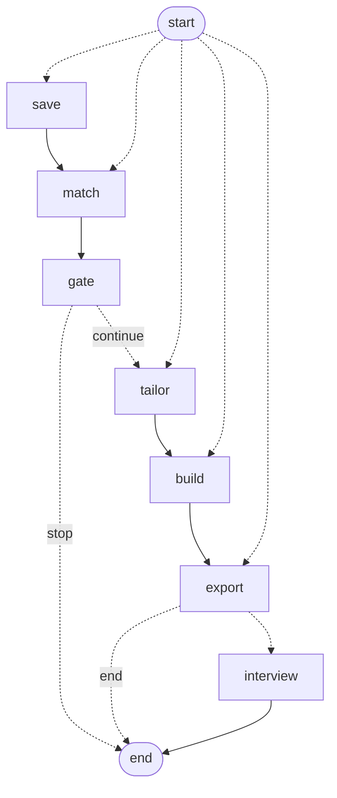

# LangChain and LangGraph in the pipeline (2026-11-25)

Three switches, each with a working fallback, so a framework never becomes the only way to run a stage.

| Layer | Switch | Framework path | Fallback |
| --- | --- | --- | --- |
| Model client | `"adapter"` in `config.local.json` | `langchain_openai`: `ChatOpenAI` sends the request (`langchain_client.py`) | `openai_http` (urllib) |
| Retrieval | `"retriever"` in `config.local.json` | `langchain`: E5 chunks as `Document`s in an `InMemoryVectorStore`, queried through LangChain's `Embeddings` (`langchain_retrieval.py`) | `native` (NumPy dot product) |
| Stage orchestration | `RAG_GENERATION_ENGINE` | `langgraph`: the backend stages run as a `StateGraph` (`backend/app/services/generation_graph.py`) | `classic` (plain Python) |

## What stays in program code

The frameworks send requests, hold vectors and route stages. They do not decide what counts as a valid answer:

- The attempt budget, JSON Schema checks, quote and number validation, personal-scope citations and correction messages stay in `local_llm.BaseAdapter`, which both adapters share.
- Chunking stays in `search_experience.py`: sections, narrative-only text and 320-token windows with 40 tokens of overlap. A section is still ranked by its best window.
- Each graph node calls the same stage method as the classic engine, and both engines raise the same exceptions.

## The generation graph

Print the current graph with `python -m backend.app.services.generation_graph`.

**Entry point.** The task decides where the graph starts:
- a full run starts at `save` (pasted JD) or `match` (JD already on disk);
- a redo starts at `tailor` (redo `tailor` or `closing`), `build` (`assemble`) or `export`.

**Branches.**
- `gate` stops the run when the evidence covers too few of the job's conditions (`coverage_gate_max_gap_share`).
- `interview` runs only for a full task that asked for it.

**Records.** Each run is checkpointed in memory under the task id. The visited nodes, their timings and the checkpoint count are appended to `graph_trace.json` in the run directory.

## Privacy

All requests go to the configured loopback model. The LangChain adapter refuses to start while `LANGSMITH_TRACING`, `LANGCHAIN_TRACING_V2` or `LANGCHAIN_TRACING` is on, because tracing would upload prompts that contain personal source text.

## How equivalence was checked

| Check | What it compares | Result |
| --- | --- | --- |
| `backend/tests/test_generation_graph.py` | Both engines, on every entry point and branch (full, pasted JD, interview, coverage gate, four redo starts, failed stage, partial match) | Identical CLI calls, stage statuses and task outcome |
| `tests/test_langchain_integration.py` | LangChain retriever against the classic one; LangChain adapter against a local fake service | Same ranking. Same request fields (`max_tokens`, `response_format`, `extra_body`); validation retries, error mapping and truncation handling unchanged |
| Live check on 2026-11-25 (local model and real corpus) | Retrievers: 74 chunks, 20 queries. Adapters: one synthetic requirement extraction | Retrievers: identical top-5 order 20/20, scores within 0.001. Adapters: identical requirements from both |

The live timings were not comparable, because the first build also warmed the model cache. No speed difference is claimed.

LangChain sends the output limit as `max_completion_tokens`. The adapter also sends `max_tokens`, so local servers that read only the older field keep the same output budget.
